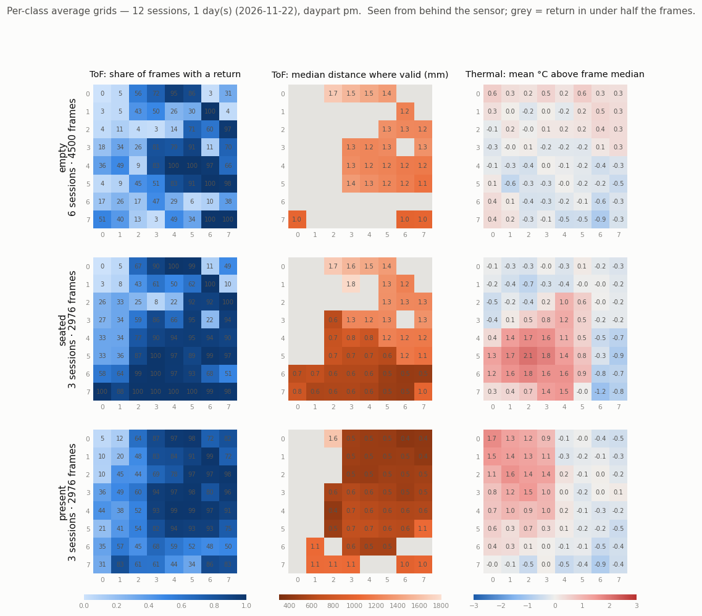
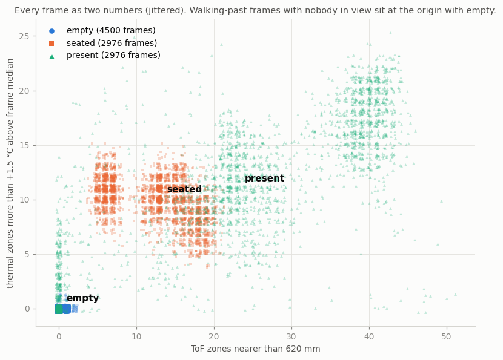
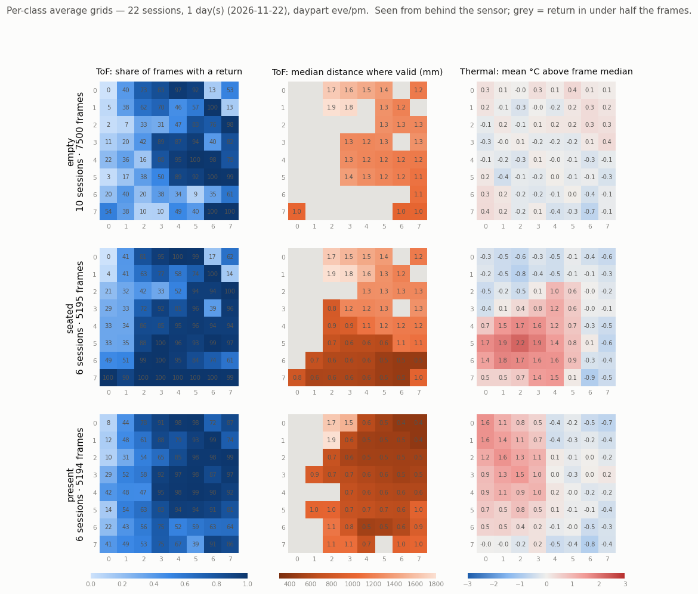
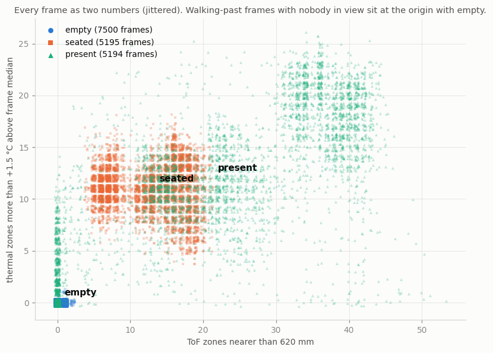
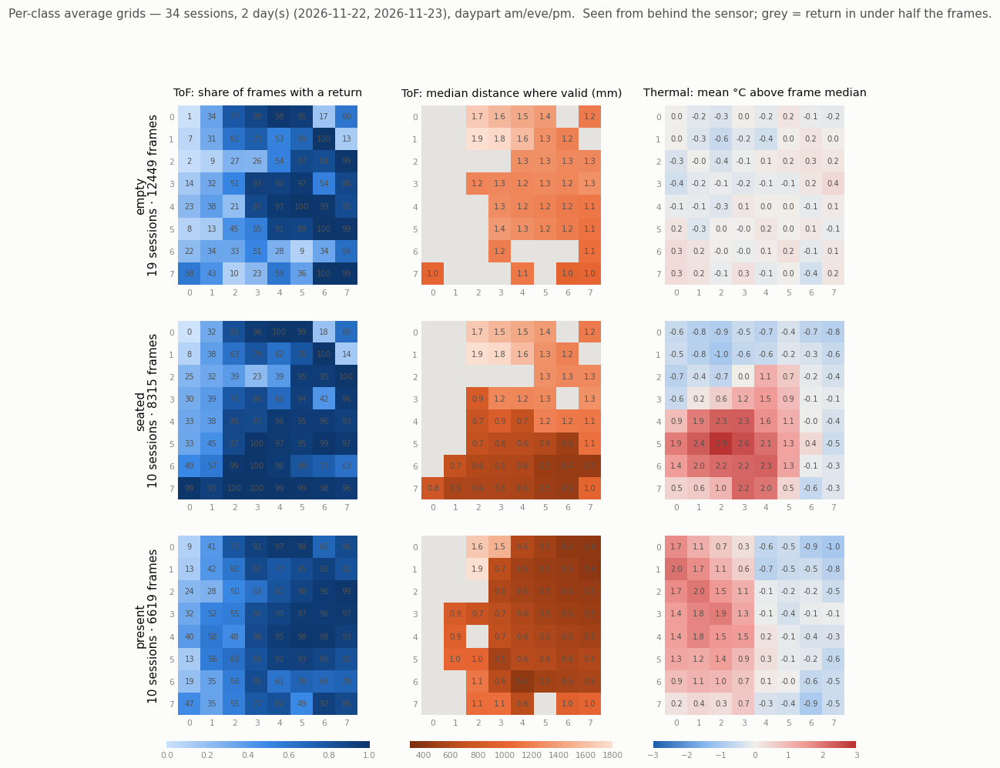
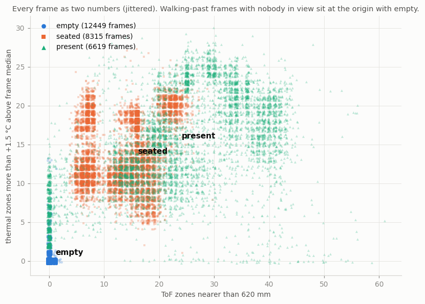

# Notes

Running record of findings and decisions. Newest phase last.

---

## Phase 1 — Hardware bring-up

### I2C bus and pin assignment

**Status: CONFIRMED on hardware, 2026-08-01.** `cargo run --release --bin i2c_scan`
against ST-LINK V3 `002300453432511530343838`.

| Bus  | SCL | SDA | Routed to | Verdict |
|------|-----|-----|-----------|---------|
| I2C1 | PB8 | PB9 | ARDUINO Uno V3 header, D15 (SCL) / D14 (SDA) | **use this** |
| I2C2 | PH4 | PH5 | On-board MEMS sensors | occupied, leave alone |

The run also confirmed the clock tree independently: embassy reported
`sys: 160000000`, `hclk1/pclk1/pclk2/pclk3: 160000000` off HSI16, which is what
`clock.rs` intends.

I2C1 is the bus for both project sensors. It reaches the ARDUINO header, and
nothing on the board is fitted to it, so the VL53L5CX-SATEL and the AMG8833
can share it without contending with the on-board devices.

Sources agree on the pin assignment:

- Zephyr's board devicetree for `b_u585i_iot02a` — `i2c1` on PB8/PB9,
  `i2c2` on PH4/PH5
- ST's `stm32ai-nanoedge-datalogger`, which lists the same two buses with the
  same pins for this board
- ST's UM2839 (board user manual) and the MB1551 schematic are the primary
  authority; the ST download of both is still worth having on disk

### Scan result

**I2C2 — 7 devices.** Six were predicted; the seventh is accounted for below.

| Addr | Part | Function |
|------|------|----------|
| 0x10 | VEML6030 | ambient light |
| 0x1e | IIS2MDC | magnetometer |
| 0x56 | M24256 | EEPROM, memory array |
| 0x5d | LPS22HH | barometer |
| 0x5e | M24256 | EEPROM, identification page |
| 0x5f | HTS221 | humidity / temperature |
| 0x6b | ISM330DHCX | 6-axis IMU |

**I2C1 — 0 devices**, as expected with nothing wired to the header.

Because every predicted address on the control bus answered, the scanner
itself is proven, and the empty I2C1 result is a real reading rather than a
broken probe. That was the point of scanning both.

**On 0x5e:** not predicted, and it is the same chip as 0x56. `0x56` is
`1010_110` and `0x5e` is `1011_110` — identical A2/A1/A0 strapping, different
device-select nibble. That is the M24256's identification page answering
alongside its memory array, which is standard for the M24 family. Inferred
from the address bit pattern rather than read off the schematic, but the
pattern is hard to explain any other way. It is on a bus we are not using and
collides with nothing, so it needs no further action.

### Resolved: there is no on-board VL53L5CX

**Nothing answered at 0x29 on either bus.** ST's marketing copy mentions a
"time-of-flight and gesture-detection sensor" and ST's own datalogger lists a
VL53L5CX against this board, but the board in hand does not have one — Zephyr's
devicetree, which models no ToF node, was right.

So Phase 1 proceeds as originally planned: the VL53L5CX-SATEL gets wired to
I2C1 on the ARDUINO header. The zero-wiring bring-up shortcut is not available,
and the ULD will be brought up against the breakout with the wiring as a live
variable. Worth remembering when the driver first misbehaves: check the jumpers
before reading the ULD source.

### Why the scanner probes both buses

I2C2's population is known in advance, which makes it a control. If the scan
reports those six addresses, then the scan logic, clock configuration and bus
timing are all proven, and the I2C1 result can be trusted. Scanning only the
bus we care about would leave "found nothing" ambiguous between an empty bus
and a broken scanner.

### Pull-ups

The on-board bus has its own pull-ups fitted, so the scanner leaves the
internal ones off for I2C2.

**The ARDUINO header lines (PB8/PB9) also carry board-side pull-ups —
confirmed empirically 2026-08-01**, not from the schematic: with the header
completely empty, both lines hold high against the STM32's ~40 kΩ internal
pull-down, which only an external resistor well under that can do. (An earlier
draft of this note claimed the header had none; the bench said otherwise.)

Consequences:

- The internal pull-ups enabled in `i2c_scan` for I2C1 are redundant. Harmless
  at 100 kHz, but they can go.
- These plus the SATEL's own 2.2 kΩ will sit in parallel. Fine at 100 kHz;
  recheck the combined strength before raising the bus speed.
- `bus_check`'s "external pull-up present" verdict detects the **board's**
  resistors, so it cannot tell whether a sensor is attached or powered. What
  it can still do is find a shorted line, which is precisely what it did.

### Debugging record: the SDA short (2026-08-01)

First wiring of the SATEL: `i2c_scan` found nothing at 0x29. `bus_check`
showed SCL high but SDA clamped to ground so hard that neither the internal
pull-up nor the board's own pull-up could lift it. With the SATEL fully
disconnected, SDA read clean high — **the short travels with the SATEL
wiring**. The board was never the problem.

Lesson that cost an hour: a line reading high through the header proves only
that the *board's* pull-up is there. The first `bus_check` verdict called SCL
"healthy — sensor powered and grounded" off exactly that misreading, and it
was Tony disconnecting SCL and seeing no change that exposed it.

Fault-isolation procedure that works, for next time: run `pin_wiggle` (live
readback every 5 s), reconnect one wire at a time, and watch for the report
where `PB9 lifts` flips to false — the wire that kills it is the culprit.

**Continued — the short was not the wiring.** Evidence accumulated in order:

1. Rewired from scratch; scan still found nothing; `bus_check` showed the
   same SDA clamp. Same fault across two independent wirings.
2. `bus_check` grew a 500 ms re-sample to distinguish a short from the
   decoupling capacitance of an unpowered rail (both read "low" at 1 ms; only
   copper stays low at 500 ms). Verdict: still low — genuinely held down.
3. DMM at the SATEL pads, powered: AVDD 5.0 V, IOVDD 3.3 V, SCL idles 3.3 V,
   **SDA pad 0 V**. With the SATEL's own 2.2 kΩ pull-up to a live rail, that
   means something sinks >1.5 mA on that net continuously.
4. Jumper wires verified; SDA-to-GND continuity on the breakout, power off:
   **no beep**. Not copper, therefore active silicon.
5. Symptom then spread: SCL stopped reading as well. A slave can only hold
   SCL by clock-stretching from a wedged state — or the part is failing.
6. `I2C_RST` pulsed high (~1 s) per its purpose as the I2C-block reset:
   no recovery, scan still empty.

**Verdict: SATEL #1 sinks its own SDA (later SCL) with good rails, no copper
short, and does not respond to its designed reset. Suspect silicon.** It sank
SDA from its very first transaction, so it may have arrived damaged. Labeled
and kept for a post-mortem against a working baseline.

Next: pre-flight the harness (wire-tip voltages with no sensor attached:
AVDD 5 V, IOVDD 3.3 V, GND continuity, both signal tips ~3.3 V from the board
pull-ups), then SATEL #2 on five wires only — AVDD, IOVDD, GND, SDA, SCL;
INT/LPn/I2C_RST left to the breakout's own resistors. Solder a header strip
to #2 first: push-fit jumpers in castellated holes are the one connection a
meter cannot vouch for, and the rig wants a solid mount anyway.

**RESOLUTION — the sensors were innocent. So was every wire.**

Both SATELs showed the identical clamp on fresh jumper wires, which finally
proved the fault systematic rather than component-level. Tony then mapped the
U585 board's header hole by hole and found it: **the B-U585I-IOT02A's ARDUINO
digital header does not start where the NUCLEO-F446RE's does.** Its first
position is unpopulated and SCL begins one hole down. Wiring by position —
F446RE muscle memory from the bacnet-gateway builds — shifted every signal
wire by one, on every attempt, on both sensors, with any wire set. On a
shifted row some wire always finds a ground or a loaded net, which is where
the unliftable SDA clamp came from.

The earlier "suspect silicon" verdict on SATEL #1 is **withdrawn** — the
chip was reacting to a miswired harness, not failing. Both sensors are fine.

With every wire placed by reading the silkscreen label at each end —
never by counting positions — the bus reads clean, and stayed clean when the
5 V/AVDD wire landed, the step that had produced the clamp on every previous
attempt.

Lessons, in the order they were paid for:

1. **Wire label-to-label, never position-to-position.** Two boards sharing a
   connector standard can still differ in physical hole layout.
2. A pin reading high through a board-side pull-up proves nothing about what
   is (or is not) connected to it.
3. A powered chip with a broken harness can actively clamp a line in ways
   that mimic a copper short — no continuity beep, immune to reset — because
   its return current or a resistor-fed rail is involved. "No beep but 0 V
   under power" means active silicon, and active silicon means look at the
   harness before condemning the part.
4. The fastest debugging tools here were a 30-line GPIO test and a
   multimeter, alternated. Neither alone was sufficient.

### VL53L5CX-SATEL wiring

Authority: **AN5717 Rev 4**, *How to setup and run the VL53L5CX-SATEL using an
STM32 Nucleo64 board*, Table 1. Pin names on our board read off the silkscreen
directly (see `images/`); the breakout carries eight pads:

`INT · I2C_RST · SDA · SCL · LPn · AVDD · IOVDD · GND`

**The supplies are not interchangeable and neither is 3.3 V:**

| SATEL pin | Connect to | Notes |
|-----------|-----------|-------|
| `AVDD` | **+5 V** | analog supply, an **input** |
| `IOVDD` | **+3.3 V** | I/O supply, also an **input** — not a regulator output |
| `GND` | GND | |
| `SCL` | D15 → **PB8** | |
| `SDA` | D14 → **PB9** | |
| `LPn` | free GPIO, or tie to 3.3 V | must be high for I2C to answer |
| `I2C_RST` | free GPIO, or tie to GND | active high; low = not reset |
| `INT` | free GPIO | optional — poll for data-ready during bring-up |

Web sources disagreed on whether `IOVDD` was an input or a regulator output,
which is exactly the kind of thing not to resolve by majority vote — driving
3.3 V into a regulator output damages the part. AN5717 settles it: both are
inputs, and they come from two different rails.

Power sequencing from the VL53L5CX datasheet: **IOVDD must come up at the same
time as, or after, AVDD.** Powering IOVDD while AVDD is dead raises leakage.
Wiring both to the board's own rails satisfies this automatically, since they
come up together.

**Convenient coincidence:** ST's reference wiring is to a NUCLEO-F401RE, where
`SCL` = D15 = **PB8** and `SDA` = D14 = **PB9** — the same STM32 port pins our
U585 uses for its ARDUINO header I2C. That is the Arduino Uno V3 standard
mapping doing its job, and it means AN5717's I2C connections transfer to this
board unchanged.

**Do not break the board.** The SATEL is perforated so the sensor mini-PCB can
be snapped off for 3.3 V flying-lead use, which is a different supply
arrangement from the one above. Table 1 describes the intact board; keep it
intact.

### AMG8833 verified with a hot mug — PASSED, 2026-08-02

Both sensors are now confirmed against real targets. The thermal response:

| Frame | Reading | What was happening |
|-------|---------|--------------------|
| 20 | span 475 | baseline, empty room |
| 22 | span 2475, `4625` bottom-left | mug entering the field of view |
| 28 | span 3850 | mug closer, hot region spreading |
| 96 | median 6675, peak 6900 | mug filling most of the view |
| 162 | span 650 | mug withdrawn, back to baseline |

Peak pixel 7150 c°C — 71.5 °C, right for hot tea. It appeared, grew and
disappeared, which is what rules out a stuck reading rather than the peak
value alone. The mug entered from the **bottom-left**, which fixes the
sensor's orientation relative to the scene.

**Finding: the sensor retains heat, and the whole image shifts with it.**

Baseline before the mug: median ~2075–2225, die 2331. Baseline twenty
seconds after removing it: median ~2200–2350, die 2456. The die gained
1.25 °C and every pixel rose with it.

A thermopile measures the difference between its own package and what it is
pointed at, so anything that warms the package shifts the entire frame. A mug
did it in under a minute; a person sitting nearby for an hour will do it more
slowly and more permanently.

Three consequences worth carrying into Phase 2 and 3:

1. **Absolute temperature thresholds will not work.** "Warmer than 25 °C
   means occupied" drifts with the sensor's own history, never mind the
   season. The frame-median reference already in `thermal_probe` sidesteps
   this by construction — half of any realistic frame is background, so the
   reference moves with the package. That design choice was made for a
   different reason and turns out to matter more than intended.
2. **Consecutive frames are not independent samples.** The sensor carries
   thermal state, so a frame recorded moments after a person leaves still
   contains them. Data collection needs settling time between classes, or
   the `empty` set will quietly contain the warm ghost of the previous
   session.
3. **This is a real signal, not only a nuisance.** A recently vacated chair
   stays warm. That is genuinely useful for occupancy — it distinguishes "was
   occupied a minute ago" from "empty all morning" — but only if it is
   deliberate rather than an accident in the training data.

### Phase 1 sensing checkpoint — PASSED, 2026-08-02

`tof_range` streaming 8×8 at 10 Hz, hand and object motion tracked correctly.
Representative frames from the first real run:

| Frame | Reading | Interpretation |
|-------|---------|----------------|
| 45 | `46..79 mm`, 57/64 valid, uniform | flat surface against the sensor |
| 190 | `481..1147 mm`, 54/64, smooth gradient | angled surface across the FoV |
| 210 | `293..1716 mm`, 60/64 | wall at ~1.5 m, object at 300 mm in one corner |
| 205 | `0/64 valid` | open space — nothing in range. Correct, not a fault |

**Two findings that matter for later phases:**

**1. Silicon temperature climbed 34 °C → 44 °C over a few minutes of ranging.**
The sensor reports this per frame (`silicon_temp_degc`) and it is a real,
self-generated hot spot roughly 20 °C above ambient. This is direct evidence
for the rig-design decision: the AMG8833 is a thermopile measuring radiated
heat, and mounting it hard against a part that sits at 44 °C would put a
permanent bright corner in its 8×8 grid — present in every class equally, so
it would quietly consume dynamic range rather than showing up as an obvious
fault. Leave a physical gap, and prefer having the thermal sensor upstream of
the ToF in any airflow.

**2. Valid-zone count swings enormously — 0/64 to 64/64 — with no fault.**
A zone reports no valid target when nothing is in range, which for
room-scale mounting will be common (ceilings, doorways, open space beyond the
sensor's reach). Phase 3 has to decide explicitly what an invalid zone means
as model input. It is *not* missing data to be imputed away: "nothing within
range in this direction" is a real, informative observation about the room.
Encoding it as 0 mm would be actively misleading — that reads as "something
touching the sensor", the exact opposite. Worth deciding before training, not
after the confusion matrix disappoints.

### FIRST LIGHT — 0x29 answered, 2026-08-02

```
I2C1  (PB8 SCL / PB9 SDA)  — ARDUINO header, D15/D14
    0x29  VL53L5CX 8x8 ToF  <-- target
    1 device(s)
```

**Root cause of the entire saga: the ARDUINO digital header is `CN13`, and
its pin order runs opposite to the assumption.** `SCL` is the **end pin**
(top right as the board sits label-up), with `SDA` immediately beside it.
Every wiring attempt before this placed those two by the ordering carried
over from the NUCLEO-F446RE, and landed them elsewhere on the row.

That single fact explains every symptom we chased for hours:

- SDA "hard shorted to ground" — the SDA wire was in a genuine GND pin of
  CN13, which is exactly what a hard short looks like, because it *was* one.
- SCL "healthy" — PB8 was reading the board's own pull-up while the SCL wire
  sat in an unrelated hole.
- Immune to `I2C_RST`, unchanged by swapping sensors, reproducible across
  three complete rewirings — because every rewiring reproduced the same
  wrong ordering.
- `find_pwren` finding nothing on A0–A5 — the sensor could not answer
  regardless of `PWR_EN`, because its data line was grounded.

Both SATELs are fine. Neither was ever damaged.

**The lesson, now paid for in full: on an unfamiliar board, establish pin
positions from the board itself before wiring anything.** Not from an
application note written for a different board, not from a devicetree, not
from a photograph — all three were consulted, and all three were consistent
with a wiring that did not work, because they described *which signal is on
which pin name* and never *which physical hole that pin name occupies*.

### The wiring (2026-08-01 — revised after the PWR_EN discovery)

**The SATEL is two boards in one, and they take different supplies.** The
carrier section has a labeled hole row and an LDO (`U1`); the perforated
mini-PCB carries the sensor and its own castellation labels. The same name
means different things on each:

- **Carrier `AVDD` hole = LDO input, takes 5 V.** The LDO drops it to the
  3.3 V the chip wants. **`PWR_EN` enables the LDO, defaults OFF, and must be
  tied high** — it is a board-control pin, not a sensor pin. AN5717 Table 1
  wires it to A5 and ST's example code drives it high.
- **Mini-PCB castellation `AVDD` = the raw chip rail, 3.3 V maximum.**
  AN5717 calls the snapped mini-PCB "a 3.3 V supply application". 5 V here
  is out of spec for the bare sensor.

**Correct hookup for the intact board — six wires at the carrier holes,
each placed by reading the silkscreen label at both ends:**

| Board label | SATEL carrier label | Purpose |
|-------------|--------------------|---------|
| `5V` | `AVDD` | LDO input |
| `3V3` | `IOVDD` | I/O rail |
| `A5` | `PWR_EN` | **LDO enable — without this the sensor is dark.** A5 = **PB0** on this board (UM2839 Table 24 + Zephyr DTS agree; a NUCLEO-64's A5 is PC0). Driven high by firmware, which also buys a programmatic hard power-cycle of the sensor later |
| `GND` | `GND` | common ground |
| `CN13` **end pin** | `SCL` | I2C1 clock (PB8). **The end of the row — top right, board label-up.** Not where NUCLEO-64 habit puts it |
| `CN13` **second pin** | `SDA` | I2C1 data (PB9). Immediately beside SCL |

`INT`, `LPn`, `I2C_RST` stay unconnected: the breakout's resistors hold
`LPn` high (comms enabled) and `I2C_RST` low (not reset). `INT` becomes
relevant when frame-ready moves from polling to interrupts later in Phase 1 —
any free header GPIO will do; ST's reference uses A1/A2/A3.

An earlier revision of this section specified five wires by castellation
label, omitting `PWR_EN` (the castellations don't have one) and sending 5 V
to what may have been the raw rail. Symptom of the missing `PWR_EN`:
perfectly clean bus, correct voltages at the input holes, and total silence
at 0x29 — a regulator that is off looks exactly like a sensor that is
absent.

**Board trap, the expensive kind:** the B-U585I-IOT02A's ARDUINO digital
header is not populated identically to a NUCLEO-64's — the first position is
empty and `SCL` starts one hole down. Position-counted wiring transplanted
from F446RE habit lands every wire one off. The full story is in the
debugging record.

---

### Re-verification after the break — 2026-09-26

The rig was built on 2026-08-03 and then not touched for eight weeks. Re-checked
before trusting anything it produces. Toolchain: Rust 1.92.0, probe-rs 0.30.0,
ST-LINK V3 `002300453432511530343838` — same probe as the August work.

Everything still works. Firmware builds clean, both buses enumerate as before:
I2C2 shows the seven on-board devices, I2C1 shows `0x29` and `0x69`.

**The AMG8833 is at 0x69, not 0x68.** This is not a regression and not a change
— the SparkFun breakout straps AD_SELECT high, and `thermal_probe` has probed
both addresses since August precisely because of it. What was wrong was the
*documentation*: the roadmap, `CLAUDE.md` and `i2c_scan`'s own doc comment all
named 0x68, and the scanner printed `<-- target` against 0x68 while the real
sensor sat unmarked at 0x69. Knowledge that lives only in a source comment is
knowledge that gets contradicted by the summary someone actually reads. Fixed
in all four places.

**Baseline before any ranging:** scene median 22.75 °C, span 2.3 °C,
die 27.6 °C. The frame is not flat — the right-hand columns run roughly 1 °C
warmer than the left. Worth knowing that this gradient exists *before*
attributing any later one to the ToF.

**VL53L5CX silicon reached 42 °C within five frames of ranging**, against the
34 → 44 °C range recorded in August — then kept climbing: 48 °C at ~5 min,
51 °C at ~8 min, still rising when the soak ended. August's 44 °C was not a
plateau, it was a shorter measurement. Two things follow. The steady-state
temperature is higher than recorded and not yet established, and the shield
is a plausible cause — soldered to protoboard the part has less room to dump
heat than it had on jumpers in open air. Treat 44 °C as a lower bound, not a
maximum, anywhere it is quoted.

### Mount geometry, and a reflectance theory that did not survive — 2026-09-26

A long bench session spent deciding where the sensor actually goes. Worth
recording in full because most of it is reasoning that would otherwise be
re-run from scratch, and because the headline hypothesis turned out to be
wrong — which is the part most likely to be repeated if it is not written
down.

#### The mount

Available gear: a Neewer desk-clamp stand with a boom, reaching **166 cm**
maximum, and a 1 m tripod. Nothing that reaches a ceiling.

Operator height is 180 cm, so **the sensor sits below head height**. That one
fact decides the product. Overhead mounting is out: you cannot stand under a
sensor at 166 cm, and from directly above, a seated head at ~130 cm is only
36 cm away, where the ToF's field spans barely 33 cm. So this is a
**wall-height, cross-room sensor**, not a ceiling one.

That is not a consolation. A sensor that works at wall height installs
anywhere; one that needs ceiling access does not — the same retrofit argument
the roadmap makes about cabling applies to mounting.

Orientations considered and rejected:

- **Facing up.** Puts ceiling luminaires in the thermal field. They are hot,
  large in a 60° field, and switch on and off *with occupancy* — precisely the
  shortcut the VEML6030 was excluded to avoid, but hidden inside 64 thermal
  pixels where it cannot be attributed. Also collects dust and sees desk
  clutter. Rejected outright.
- **Straight down.** Correct geometry in principle — no occlusion, floor as a
  constant baseline, head height maps to distance, and it makes `sitting` vs
  `standing` nearly free. Impossible at this height for the reason above.
- **Tilted down, facing out.** What we settled on.

#### Sensor arrangement — the thermal question answered itself

Mounting the board in portrait for the tilt happens to put the **GridEYE below
the SATEL**. The ToF's plume therefore rises away from the thermopile instead
of across it, which is the arrangement the earlier TODO wanted and would
otherwise have needed shield rework. Convection is no longer the concern;
only conduction through the shared protoboard remains, which is a much weaker
effect and still unmeasured.

Rotating to portrait **voids the earlier orientation characterisation**. The
hot-mug finding that a target "entered from the bottom-left" no longer holds,
and the SATEL's grid orientation was never established at all. Both need
redoing in the final pose. One provisional data point arrived for free: with a
vertical target (A3 sheet held at chest height), **row 0 reads nearer than
row 1**. On a flat vertical surface the closest point is the one level with the
sensor and points below are farther, so **row 0 is the top of the world view**.
Confirm with the mug before relying on it.

#### What the ranging actually showed

Empty room, final pose, typical frame:

```
 -1    -1    -1   1893  1743   -1    -1    -1
 -1    -1   1940   -1    -1    -1    -1    -1
 -1    -1   2298   -1    -1    -1    -1    -1
 -1    -1    -1    -1    -1    -1    -1   856
 -1   2034   -1    -1    -1    -1    -1   889
1845  1909   -1    -1    -1    -1   1004  916
1719  1778  1792  1276  1244   -1   1073  971
1599  1652  1656  1198  1208  1208  1156  984
```

- **A persistent strip down column 7 at 0.85–0.98 m.** Static, one column wide,
  nearest at the top — the signature of a flat surface at the frame edge. The
  assembly is mounted hard against the door jamb; most likely that. Move the
  boom clear of it.
- **Only 24–26 of 64 zones valid.** Three-quarters of the array is pointed at
  space beyond useful range.
- An earlier pose over the desk produced 0.98 m returns across the bottom rows.
  Useful invariant for diagnosing these: **from a sensor at height h, the slant
  range to the floor can never be less than h.** Anything reading below 1.66 m
  here is an object, not the floor.

#### The reflectance test — hypothesis rejected

A person standing ~2 m away (near the shoe rack) produced **no detectable
change at all**: 22–25 valid zones against 24–26 empty, same pattern
everywhere. An A3 white sheet in roughly the same area showed up clearly.
Initial reading: the ToF cannot see dark clothing or dark skin at 940 nm,
which would have been a strong argument for sensor fusion.

**That reading was wrong.** Two confounds, found by making the test stricter:

1. **Target size, not surface.** At 45° across 8 zones, each zone subtends
   ~5.6°, so **one zone covers roughly 15 cm at 1.5 m**. A bare forearm
   (~10 cm) underfills a single zone and returns weakly and intermittently.
   The A3 sheet (30 × 42 cm) fills two to three zones completely. That alone
   explains the difference with no reflectance effect whatsoever.
2. **The spot moved between captures**, and a fluorescent light was switched
   on partway through, changing ambient IR as well as the target.

The size-matched, fixed-lighting repeat settles it. Same position, same pose,
light off, A3 held flat against the chest and then dropped:

| zone  | empty | paper on chest | person, no paper |
|-------|-------|----------------|------------------|
| r0 c3 | 1893  | 1478           | **1510**         |
| r0 c4 | 1743  | 1403           | **1450**         |
| r0 c5 | —     | —              | **1488**         |
| r1 c3 | —     | 1663           | **1731**         |
| r1 c4 | —     | 1617           | **1624**         |

**The unaided person returns more zones than the paper, not fewer.** Grey
clothing and dark skin are both perfectly adequate 940 nm targets. Melanin
absorption falls off steeply above ~700 nm, so skin-tone variation in the near
infrared is far smaller than in visible light — a genuine advantage of active
NIR sensing over camera-based approaches, and worth stating in the write-up.
Visible colour is in any case a poor predictor of NIR reflectance: carbon-black
absorbs across both, while many dyes that look dark are bright at 940 nm.

**Consequence: the earlier null was position, not surface.** At ~2 m the
subject was outside the usable cone. And the fusion argument this looked like
it was going to supply **does not exist** — do not write it up. If fusion needs
justifying, it has to be on something real, most likely stationary occupants,
where the thermopile sees what the ToF cannot.

#### Confirmed problem: only two rows are usable

Every person-height return, in every capture, landed in **rows 0–1**. Sixteen
of sixty-four zones. The remainder is near floor, the door-jamb strip, and
out-of-range space.

Geometry says a person at 2 m spans ~44° from head to feet, almost exactly the
sensor's 45° field — they should nearly fill the frame. Landing on the top two
rows means the array is aimed far too steeply, at floor much closer in.
**Aiming criterion: adjust the tilt until a person at working distance sits in
the middle rows, not the top edge.** Training on 16 usable zones would sink
Gate 3.

#### Resolution ceiling

Zone size is roughly **10% of range**. A 45 cm torso covers about 3 zones at
1.5 m, 1.5 zones at 3 m, and a single zone at 4.5 m. Past ~3 m a person stops
having a shape and becomes one pixel, so anything posture-based — which is
what separates `sitting` from `standing` — has a hard ceiling around there.
This argues for a deliberately close sensing zone and supports framing the
product as **workstation occupancy** rather than room-scale coverage.

#### Data quality note: a literal 0 mm reading

One frame returned **0 mm** at r7 c0. Zero is physically meaningless — nothing
is touching the cover glass. The driver is emitting 0 as a value rather than a
sentinel, so unfiltered it would assert the exact opposite of the truth. This
sharpens the open TODO on invalid-zone encoding: "invalid" is not one
condition. Out-of-range, too-dark-to-return, and a spurious 0 are three
different things and should not collapse into one number. Decide before any
CSV is recorded.

#### Lighting must be a controlled variable

A fluorescent lamp was switched on mid-session and contaminated a comparison.
Three reasons it matters:

- The VL53L5CX supplies its own 940 nm illumination and works in darkness.
  Ambient IR only adds shot noise and **reduces** effective range — switching a
  light on to help it see works against you.
- A lamp is a warm object for the GridEYE, and it is on when people are
  present. Same shortcut family as the ceiling lights.
- It changed between two captures that were being compared.

**Rule for Gate 2: pick a lighting state and hold it for every capture, or
record it per session and balance it across classes. Never let it track the
class.** The photographic lamp on the stand is for filming — which means it is
on exactly for the sessions that produce video ground truth. Same rule applies.

#### Open

- Reduce the tilt until people land in the middle rows; re-baseline the empty
  room afterwards, since every number above is tied to the current pose.
- Move the boom clear of the door jamb and confirm column 7 frees up.
- **Measure usable depth:** walk out in half-metre steps and record where
  detection is lost. Detection is solid at ~1.5 m and absent at ~2 m, but
  whether that is the cone or the range is not yet known. That number decides
  the size of the zone the product can honestly claim.
- Redo the hot-mug orientation characterisation for both sensors in the final
  pose, and confirm row 0 is the top.
- Mark the ball head, clamp position and column extension. A long column with
  an offset load on a ball joint, clamped to a desk people lean on, is the
  geometry-drift risk in physical form.
- The sunlit window is an uncontrolled thermal source: sunlit patches are warm,
  move through the day, and correlate with time rather than occupancy. Collect
  across times and weather; record as a known limitation.

### Fusion demonstrated: ToF blind, thermal clear — 2026-09-26

The best measurement of the session, and the one worth building the write-up
around. Four captures, same pose, same lighting, minutes apart, each with its
control.

**Setup.** Sensor at 166 cm on the boom, tilted **15° below horizontal**
(reduced from ~34° earlier in the session — see the derivation below).
Subject 180 cm tall, standing 180 cm from the sensor in a doorway. A Philips
tower fan, not running, at 130 cm. Room lighting off and unchanged throughout.

#### Setting the tilt, derived rather than guessed

A 180 cm person at 2 m, seen from 166 cm, spans from **+4.0°** (head, 14 cm
above the sensor) to **−39.7°** (feet, 166 cm below): 43.7° of vertical angle
against a 45° field. They should almost exactly fill the frame, and the
midpoint of that span is **−17.9°**. 15° was chosen to bias slightly toward
keeping the head in frame at the cost of the feet.

Sanity check in the other direction: at 75° below horizontal the field spans
52.5°–97.5° depression and a person at 2 m is entirely outside it. The angle
is measured **from horizontal**; the board ends up nearly upright, leaning
back slightly. At 15° the axis drops 27 cm per metre, so from 166 cm the aim
point is 112 cm high at 2 m.

The change did what it was supposed to: valid zones went from 24–26 to
**38–42 of 64**.

#### ToF: the subject is invisible

Empty and occupied frames are identical to within tens of millimetres.

| zone | empty | subject at 1.8 m |
|------|-------|------------------|
| r2 c1 | 1811 | 1822 |
| r3 c1 | 1756 | 1713 |
| r4 c1 | 1714 | 1664 |
| valid zones | 39–42 | 38–41 |

**Cause: no depth contrast.** The subject is 180 cm from the sensor and the
wall behind them already reads **1.71–1.98 m** in those same zones. A ToF
measures distance; a person standing against a background at their own range
has almost nothing to be nearer *than*. The residual shift is ≤5 cm, which is
inside the frame-to-frame variation.

This is a fundamental property of the sensor, not a defect and not a tuning
problem. It is also not reflectance — that hypothesis was tested and rejected
separately (see the previous section).

#### Thermal: the subject is obvious

Difference map, subject minus empty, in centi-°C:

```
col:      1     2     3     4     5
row0:   +25  +150  +350  +325   +50
row1:     0  +250  +200  +200   -25
row2:   -25  +125  +250   -25   -50
row3:     0  +100  +200     0   -75
```

A contiguous blob across columns 2–4, rows 0–3, peaking at **+3.5 °C** over a
21.0 °C background. Frame span doubles from 200–250 c°C empty to 475–550 c°C
occupied.

#### The asymmetry is the whole argument

- The **fan** dominates columns 3–7 of the ToF frame and is **completely
  invisible** to the thermal sensor — it sits at ambient, so thermally it does
  not exist.
- The **person** is invisible to the ToF and unmistakable in the thermal.

One frame pair, both failure modes, in opposite directions. Each sensor is
blind to exactly what the other sees clearly. That is a demonstrated reason to
fuse them, and it is far stronger than the usual assertion that two modalities
are better than one. **This pair belongs in the blog post.**

#### Caveats, recorded honestly

**Zone averaging dilutes temperature.** The subject peaks at 25.0 °C, not the
~31 °C of real skin and clothing. At 1.8 m each thermal zone covers about
24 cm, so a zone containing part of a person and part of a wall reports the
mixture — roughly 40% fill on the hottest zone. Absolute temperature
thresholds will therefore be unreliable at distance, which argues for a
learned model over a fixed threshold. It also means apparent temperature falls
with range, so range and class must not be correlated in the training set.

**Global drift between captures.** Off-target zones moved by up to ±125 c°C
between the two frames, while the die temperature moved 0.19 °C and the frame
median 0.13 °C. The peak signal is therefore only about **3× the background
drift** — a real result, but not a comfortable margin. This is direct evidence
for the HTS221 ambient-reference item: slow ambient drift currently rides on
top of every reading and can masquerade as signal.

#### Consequences for the collection procedure

- **Site the sensing zone so subjects have depth behind them.** A doorway with
  a wall at arm's reach is the worst case available, which made it a useful
  accident. Aim across open space so the background is well beyond the subject.
- **Keep clutter out of the near field.** The fan is a metre-tall, highly
  reflective column at 130 cm occupying more than half the ToF array. Move it,
  and treat "nothing within ~1 m of the field" as a precondition for any
  capture.
- The ToF cannot be the sole presence signal at these ranges. Any class
  definition that assumes it will see a stationary person against a wall is
  wrong.

### Thermal dilution, and why peak temperature cannot classify — 2026-09-26

A hot mug of coffee turns out to be the most instructive target of the day.

#### Dilution is quantitative and it dominates at range

Mug held at 1.8 m: a single dominant zone at r1c4, **+2.75 to +3.0 °C** over a
21.0 °C background, with +1.0 to +1.5 °C spill into two neighbours.

At 1.8 m an AMG zone covers ~23.6 cm, so ~557 cm² of scene. A mug presents
roughly 8 x 10 cm to the sensor — about **14% fill**. Working back from
+3.0 °C gives an outer surface near **42 °C**, which is right for ceramic
with hot coffee inside: the wall is far cooler than the liquid.

Compare the bench test of 2026-08-02, where the same class of object read
**71.5 °C** at desk distance and filled most of a zone. Same object, same
physics: 71.5 °C at ~25 cm, +3 °C at 180 cm. **Apparent temperature is a
function of range**, and at room distances dilution dominates everything else.

#### Peak temperature does not discriminate — extent does

| target | peak Δ | zones |
|--------|--------|-------|
| person at 1.8 m | +3.5 °C | 6–8 |
| coffee mug at 1.8 m | +3.0 °C | 1–2 |

A classifier thresholding on the hottest pixel calls a hot drink an occupant,
with near-identical confidence. The discriminator is **spatial extent**, about
4:1 between them. The 8x8 structure is not a refinement over a single-pixel
thermopile — it is the entire reason this works.

Consequences:

- **No fixed temperature thresholds.** They cannot survive varying range.
- **Range must not correlate with class** in the training set, or the model
  learns distance instead of posture.
- **Named false-positive class for the limitations section:** hot drinks,
  laptop vents, radiators, a recently vacated chair. Small hot things look
  like distant people to anything measuring temperature alone.

#### Three objects, three signatures

- **Fan** (130 cm) — dominates columns 3–7 of the ToF, thermally absent
  entirely; it sits at ambient.
- **Person** (180 cm) — invisible to the ToF against a wall at their own
  range, thermally broad and obvious.
- **Mug** (180 cm) — thermally bright, spatially tiny, ToF-negligible.

No single sensor and no single statistic separates all three. This is the
strongest form of the fusion argument available, and every leg of it is now
measured rather than asserted.

#### Orientation mapping — first position, and it already found something

Protocol correction worth recording: the probe must be **alone** in the frame.
A first attempt with the mug held near the subject's head was uninterpretable,
because the person is a 6–8 zone target and the mug is a 1–2 zone one — the
small source vanishes inside the large one, and the frames changed between
captures from movement.

First clean position — mug on a stool, centre, 180 cm out, **48 cm high**,
subject out of view — lands at **r2 c3**, +1.25 to +1.5 °C.

That **does not match prediction**. The mug is 118 cm below the sensor at
180 cm out, so 33.2° below horizontal; with the axis nominally at 15° that is
18.2° below the axis, which at 7.5° per row should be the **seventh row from
the top**. It landed in the third.

Two candidate explanations, not yet separated:

1. **The AMG grid is vertically flipped** — displayed row 0 is the *bottom* of
   the world view. That alone moves the prediction to displayed row 1, one row
   from what was seen.
2. **The tilt is not 15°.** A flipped grid plus a true tilt near 22° predicts
   r2 exactly. That would mean the ball head crept between setting the angle
   and the capture — the drift risk already on the list, showing up in data.

Note this **contradicts the provisional ToF finding** that row 0 is the top.
There is no reason two independently mounted breakouts should agree, and
every reason to establish each separately.

Signal strength caveat: the mug had cooled from +3.0 °C to +1.25 °C over about
twenty minutes, which is at the inter-capture drift floor. Reheat between
positions or the mapping will be ambiguous where it most needs to be sharp.

### AMG8833 orientation map — resolved, 2026-09-26

> **Superseded 2026-11-22: the vertical conclusion below is wrong.** A live
> sweep in the viewer shows raw row 0 is the *top* of the view. See "AMG8833
> orientation — corrected" further down. The horizontal finding stands.

Resolves the ambiguity left open in the previous section. Established by
moving a boiling-water mug to known positions and, for the direction
questions, by sweeping it live in `tools/heatmap_viewer.py` — which answered
in seconds what capture-and-analyse had spent eight round trips failing to
pin down.

> **Standing behind the sensor and looking out along its axis: column 0 is on
> your left and column 7 on your right. Row 0 is at the bottom of the view and
> row 7 at the top.**

So the grid is **horizontally normal and vertically inverted** in the sensor's
own frame.

Evidence:

- **Vertical.** Mug at 180 cm out, centre: 48 cm high → r2; raised to 120 cm
  → r4. Higher in the world gives a *higher* row index. Predicted 2.5 rows of
  movement, observed 2 — within single-zone quantisation.
- **Horizontal.** Facing the sensor and moving the mug to the right moves the
  blob *left* on screen. The subject's right is the sensor's left, so
  sensor-left maps to low column numbers. Consistent with the earlier capture
  where a 50 cm lateral move ran c3 → c5.

#### Bonus: the sensor measured its own mounting angle

With the row map known, each mug position gives an independent estimate of the
optical axis:

- mug at 120 cm sits 14.3° below horizontal, lands +3.75° above axis → **18.1°**
- mug at 48 cm sits 33.2° below horizontal, lands 11.25° below axis → **21.9°**

So the mount is at roughly **20°, not the 15° that was set**. The 4° spread is
single-zone quantisation. Either the ball head crept after the angle was set,
or 15° was never achieved — the drift risk already on the list, showing up in
data within an hour of being flagged.

Worth keeping as a procedure: **two known targets at different heights
recover the mount angle**, with no inclinometer and no trusting the ball head.

#### Consequence: everything watched today was upside down

Every heatmap in this session rendered with the floor at the top. **Fix it in
the driver, not the viewer** — one place, so the CSV, the model input and the
live display all agree with the world. Flipping only the viewer leaves
recorded data disagreeing with what was watched while recording it, which is
the worst of the three options.

#### Still open, and it is the one that costs: ToF registration

The ToF's orientation is **not** established. The only evidence — A3 sheet
held against the chest, where r0 read nearer than r1, which on a vertical
surface means r0 is higher — points to **row 0 being the top**, the opposite
of the AMG.

If that holds, the two grids are vertically opposed. Gate 3 concatenates them
into one 128-value vector, so the model would be handed two mirror-image views
of the same scene: recoverable by a dense net at the cost of capacity, and
actively wrong for anything convolutional. Establish it before a single frame
is recorded.

### Choosing a thermal probe: area beats temperature — 2026-09-26

A 450 °C miniature soldering iron was considered as a stronger probe than the
mug and rejected on the arithmetic, which follows directly from the dilution
result.

| probe | radiating area | excess over ambient | zone fill at 1.8 m | predicted Δ |
|-------|----------------|---------------------|--------------------|-------------|
| mug | ~80 cm² | ~21 °C | 14% | **+3.0 °C** (observed) |
| iron tip | ~0.3 cm² | ~430 °C | 0.05% | +0.2 °C |
| iron barrel | ~5 cm² | ~180 °C | 0.9% | +1.6 °C |

The mug wins because it is **large**, not because it is hot. At room distances
the zone-fill fraction dominates everything else.

Second reason to reject it: the AMG8833 measures roughly **0–80 °C**. Close
enough to fill a zone the iron saturates and the reading is meaningless; far
enough not to saturate it is diluted into the noise. Bad at both ends.

**What a good probe looks like:** large area, moderate temperature, high
emissivity. A hot water bottle is close to ideal — big, holds temperature for
an hour so no reheating between positions, and fabric or rubber is near
emissivity 1.

**Better still, one target both sensors can see.** Mapping the thermal grid
with a mug and the ToF grid with a sheet means two probes, two placements and
two sets of positioning error before the two maps can even be compared. A hot
water bottle taped behind a piece of card gives the ToF a flat surface at a
known distance *and* the thermal a warm area in the same place — so whether
the two grids agree becomes directly readable rather than inferred. Build one
before resuming.

#### Why the ToF sweep was unreadable

Attempting the same sweep on the ToF with the A3 sheet gave a blob "all over
the place". Two causes, both fixable:

- **Scene clutter.** The fan still occupies half the array at 130 cm, and the
  sheet competes with walls and floor. Hold the target clearly nearer than its
  background — at 1.2 m against a 1.8–2.0 m wall there is 60–80 cm of
  separation and it stands out unambiguously.
- **Per-frame auto-scaling in the viewer.** The colour mapping rescales every
  frame, so in a busy scene everything appears to jump. This is the
  `--fixed-scale` item already in TODO: auto-scaling is right for aiming at a
  single target and wrong the moment frames are being compared. This session
  is the argument for implementing it.

### AMG8833 orientation — corrected, 2026-11-22

The driver-level orientation correction went in today (`orientation.rs`),
with the AMG8833 set to `flip_rows` per the September finding. Checked live in
`tools/heatmap_viewer.py` with a warm target: **raising the target moved the
blob down the screen.** With the flip removed, up is up and left is left.

> **The AMG8833's raw grid is already in the world frame: row 0 at the top,
> column 0 on your left, seen from behind the sensor. `ORIENTATION` is
> identity.**

So September's "vertically inverted" was wrong, and "everything watched today
was upside down" was not true either.

**Why the remount doesn't explain it.** The board was remounted on the stand
this morning, which looks like an easy explanation, but no remount can produce
this result. Moving a rigid board only rotates its grid: a half turn
reverses both axes, a quarter turn swaps rows for columns. A change in **one
axis only** is a mirror image, and no physical motion makes one. Horizontal
was re-checked today and still agrees with September, so the board was not
turned, and the September vertical reading was in error. Likeliest cause: the
two-position mug capture (r2 → r4) was made with a cooling mug at the drift
floor, and the "live sweep" that confirmed it may have read the direction
against whatever the screen showed rather than against row indices.

**What the remount does explain:** the drop to 5-8 valid ToF zones on an empty
scene this morning, and it voids September's ~20° mount-angle measurement.
Both need redoing in the new pose.

**Lessons.**
- Verify a correction *through the correction*. The flip was only shown to be
  wrong because it was checked on screen after being applied, not assumed.
- A one-axis change between sessions is a measurement error, not a moved rig.
  Rigid-body motion can only produce rotations — use that as a sanity check.
- The ToF's only evidence also says row 0 is the top, so the feared
  mirror-image registration problem may not exist. Still unconfirmed.

### ToF orientation and registration — 2026-11-22

> **VL53L5CX: `flip_cols` only. Raw row 0 is the top of the view; raw
> column 0 is on the right, seen from behind. Both grids now share the world
> frame, and registration is checked.**

**Vertical and transpose** came from a card swept at ~1.2 m in the viewer:
raising it moved the blob up a column, unflipped. Easy and unambiguous.

**Horizontal could not be settled by watching.** Reported reversed with the
raw grid, then reversed again with `flip_cols` — after confirming the board
was running the flipped build, and checking that `tof_range` applies the flip
to distance and status before printing. Both cannot be true; the observer's
left was the variable. Holding a target out in front of a sensor means facing
it, and "your left" is then its right.

**Settled by registration instead,** which needs no viewpoint at all. A hot
mug pressed against a card, held clearly to one side at ~0.85 m, captured
back to back:

- ToF: an object at 0.80–0.99 m in **columns 0–2**, all rows.
- Thermal: up to +5 °C over a 24 °C median in **columns 0–2**, all rows;
  columns 3–7 flat.

The AMG grid was already verified, so it is the reference: the ToF agrees with
it *with* the flip, and would put the target in columns 5–7 without it. Both
blobs run the full height because the holder's arm and body are in frame too;
that does not touch the column answer.

The result also matches UM2884 §2.2 (zone 0 sees the scene's **top right**),
so datasheet and bench agree, and the 2026-09-26 A3-sheet hint (row 0 is the
top) was right.

**Lesson, now in the TODO procedure:** don't judge left/right by eye. Compare
the two sensors against one dual-modality target. Once one sensor is known,
the other is measured against it, and nobody's viewpoint enters into it.

> **Correction, same day:** the evidence above was weaker than written. The
> thermal blob that "agreed" was almost certainly the *holder's body*, not
> the mug — and the body is on the opposite side of the card from the arm
> holding it, so a wrong flip could equally have produced the match. The
> conclusion survived an unconfounded test; see "Re-aim, and registration
> settled properly" below.

**Not yet done:** cell-for-cell agreement. The ToF field is ~45° against the
GridEYE's ~60°, so their cells differ in size, and the two breakouts sit a few
centimetres apart. Same columns at 0.85 m is the pass for direction; how
closely the grids align across the field needs a target stepped across it,
and matters for Gate 3's input layout.

### Re-aim, and registration settled properly — 2026-11-22

#### The new pose

The rig moved twice today. First pose: desk clamp at the **front-left** corner,
board on top of the pole. The seated subject was 0.5–0.9 m away — too close:
at 0.7 m the ToF field is ~60 cm wide, so a seated torso overflows it and a
standing subject's head leaves the frame.

Second (current) pose: clamp slid to the **back-left** corner against the
wall, board on the **end of the horizontal boom** over the desk, about head
height, facing the chair. Seated subject at roughly 1.0–1.1 m. Then
**tilted down ~20°**, derived from the thermal image: a target at seated
chest height on the chair landed in row 6 (~19° below axis) and now lands in
rows 4–5.

The boom puts an offset load on a ball joint at the end of a long lever —
the geometry-drift risk, larger than before. Mark it.

#### What the seated captures showed — the ToF can't see the subject here

Comparing seated against empty, zone by zone, at the second pose before the
re-tilt:

- **Thermal:** clear. Head at rows 3–4, torso below, columns 3–7, peak
  29 °C over a ~24.75 °C room.
- **ToF:** the only change was a **cool** object at ~0.6 m in columns 0–1 that
  did not move when the subject leaned hard to one side. Not the subject —
  almost certainly the chair's armrest, shifted by sitting down. Where the
  thermal sensor sees the subject, the ToF reads 1.26–1.45 m, matching the
  empty scene.

So the ToF does not separate a seated person from the black leather chair
and the armchair behind it, which are at nearly the same range. Same failure
as September's wall, in a new form: **no depth contrast, and dark surfaces
returning little.** Unresolved; it's the open question for this pose.

#### Registration settled — the hand test

Two-position tests with a mug and card on the chair were too weak (the target
smeared into the chair at the same depth, and moved under a thermal column
between positions). What worked:

**An open hand ~17 cm in front of the board, on the pole side, with the
holder standing on that same side.** Close enough to dominate both sensors,
and nothing warm or near on the other side to pull either sensor the wrong
way.

- ToF: near returns (157–191 mm) solid to the **right edge**, columns 6–7;
  gaps and background at column 0.
- Thermal: 30 °C band across the top, strongest in **columns 4–7**. Sits
  higher than in the ToF because the GridEYE is mounted below the SATEL —
  a few cm of baseline is a large angle at 17 cm.

Ground truth from the photos, not from anyone's left/right: the pole is on
the board's left *seen from the room*, so on the **right seen from behind**,
which is column 7 in the world frame. Both sensors agree with it.
**Current orientations stand: AMG8833 identity, VL53L5CX `flip_cols`.**

**Lessons.**
- The holder's body is the strongest thermal target in the room. Any
  registration test where a person is in frame on the *other* side of the
  target is confounded.
- Define directions by fixed furniture (pole side, window side), never by
  "your left".
- At close range, expect the two sensors to disagree vertically by
  parallax. Use close targets for direction only.

#### After the ~20° re-tilt: both sensors see the seated subject

Seated vs empty, same chair position, medians per zone:

- **ToF:** ~22 of 64 zones change, all in **columns 0–4, rows 2–7**; the right
  half matches empty to within 2 cm. Head and shoulders go from **no return
  to 0.52–0.57 m**, and torso/lap zones from ~1.2 m to 0.87–0.95 m. Valid
  zones: empty 31–33, seated 40–45.
- **Thermal:** empty flat (2.5 °C span); seated, head at rows 2–3 columns
  3–4 at ~30 °C, torso below in columns 2–5, about +5 °C over the room.

The surprise is *why* the ToF sees the subject: **the empty black leather
chair back returns nothing**, and a body in front of it returns strongly. So
the empty signature here is a block of invalid zones, and occupancy shows up
as invalid → ~0.5 m. Two consequences:

- The invalid-zone encoding question in TODO is now load-bearing for this
  pose: "no return" *is* the empty-chair signature. Encoding it as 0 mm or
  dropping it would erase the main ToF signal.
- The chair is part of the sensor. A different chair, a jacket over the
  back, or the chair rolled away all change the empty signature. Fix the
  chair and its position for collection, or deliberately vary it.

The empty thermal frame kept a faint **+1 °C patch at the bottom left: the
seat, still warm** a minute after the subject left. The settling-time item
in TODO, now visible in this pose.

### Combined stream — 2026-11-22

`fused_stream` pairs both sensors on one bus. First hardware run: 66 pairs
in ~13 s, device clock spacing exactly 200 ms after the first frame, no
failed reads, subject in the same place in both grids.

Design choices worth keeping:

- **ToF sets the pace** (it has data-ready); the AMG8833 is read *first*
  (~12 ms) and the ToF results second (~100 ms at 100 kHz), so the pair skew
  is bounded by the AMG's 10 Hz internal update, not the long transfer.
- **5 Hz**, not 10: the ToF results transfer alone takes most of a 100 ms
  period at 100 kHz. Raising the bus (TODO) would buy 10 Hz back.
- **Raw distance plus status, never -1.** The first live run already showed
  three statuses where `tof_range` printed one "invalid": 5 (valid), 255
  (no target) and 10 (valid range, no target in the previous frame). In this
  pose "no return" is the empty-chair signature, so the encoding decision
  matters and is deferred to training, where it is reversible.
- The first frame after `start_ranging` is all-invalid — drop it.

### Mount angle, measured by the board itself — 2026-11-22

**The rig points 49.9° below horizontal.** Read from the on-board ISM330DHCX
accelerometer (`tilt_check`): gravity (x 200, y −623, z +776 mg), |g| 1.015,
noise ~2–7 mg over 104 samples. Roll 162° about the optical axis, recorded
as this mount's reference.

**Getting there.** The two-target tape-measure method failed in this room.
The high mug (45 cm up, 115 cm out) sat inside the seat's own warmth, so the
"target" was a 16-zone warm patch, not a mug; the floor mug was invisible.
The ToF explained why: nothing in its view is farther than 1.54 m, and from
165 cm any line of sight to the floor is at least 1.65 m — the floor is
hidden behind the desk edge, chair and armchair. The ~34° it produced was the
warm seat's centroid, and is wrong.

**The sign was established, not assumed.** The first build took the IMU's +Z
as the optical axis and reported 50° *up* — impossible for a sensor that sees
a seated head below it. On this board the sensors look along the IMU's −Z.
The corrected figure agrees with independent data: the seated head appeared
~7° above the thermal axis (≈42° below horizontal), ~40 cm below the board,
which puts it ~0.6 m away — and the ToF measured it at 0.52–0.57 m.

**Consequence for Gate 2.** At ~50° down, the thermal field spans roughly
20°–80° below horizontal and the ToF 27°–72°. The view is a steep look down
at a seated person from close range. A *standing* person's head is above the
board and out of frame entirely. That is fine for presence, but it weakens
`standing` as a class, and should be decided before collection: either
accept "seated / present / empty" as the claim, or raise the tilt for a view
that includes standing posture and re-check seated visibility.

**Drift detection is now one call away.** `ism330dhcx::tilt()` is in the
library. Next: read it at the start of every `fused_stream` session and
record it, so a knocked rig shows up as a number instead of as label noise.

### Thermal soak — PASSED, 2026-11-22

Twelve minutes of `fused_stream` in an empty room, from a cold ToF (powered
off beforehand), 3,560 paired frames, no read failures.

| minute | ToF silicon | AMG die | frame median |
|-------:|------------:|--------:|-------------:|
| 0 | 42 °C | 30.43 °C | 25.75 °C |
| 3 | 47 °C | 30.18 °C | 26.00 °C |
| 6 | 46 °C | 30.18 °C | 25.75 °C |
| 11 | 46 °C | 30.12 °C | 25.75 °C |

The ToF self-heats by about 6 °C and plateaus near 47 °C. The AMG8833's die
does not follow it at all — it drifts *down* 0.3 °C. Zone by zone, minutes
1–2 against the last minute, relative to the frame median: largest rise
**+0.25 °C** (one LSB, at the noise floor), mean absolute change 0.08 °C. No
fixed warm region forms anywhere.

The only structure is a −0.25 to −0.38 °C *cooling* across rows 5–6, centre:
where the seat sits. That is the seat's residual warmth leaving, not the rig.

Verdict: the portrait mount with the GridEYE below the SATEL removes the
convection path, and conduction through the protoboard is below measurement.
The rig does not contaminate its own thermal image. (August's "44 °C" and
September's "51 °C and climbing" were with different mounts and longer runs;
this mount plateaus at ~47 °C in this room.)

One disturbance at minute 7 — median +1 °C and ToF valid zones 32 → 40 for
under a minute, something entering the view — falls outside both comparison
windows.

### Class set narrowed: empty / seated / present — 2026-11-22

Decided after measuring the mount at 49.9° down. The thermal field covers
roughly 20°–80° below horizontal; a standing person's head is above the
165 cm board and never in frame. Telling `standing` from `walking_through`
would rest on a torso and legs at the edge of the view — not something this
placement can claim honestly. So:

- `empty` — nobody in view, chair at its marked position
- `seated` — one person in the chair at the desk
- `present` — in view but not seated (standing at the desk, reaching
  across, walking past)

The product claim becomes workstation occupancy. The alternative — raising
the tilt to bring standing into view — was rejected because the steep view
is what gives the ToF its contrast on a seated person (the black chair
returns nothing; a body in front of it returns strongly).

### Mount angle in every frame — 2026-11-22

`fused_stream` now reads the ISM330DHCX on I2C2 alongside the pair: a 1 s
averaged reference at start (`mount tilt …`) and one sample per frame on the
tof header, recorded as `tilt_deg` / `roll_deg`. First run: reference 50.2°,
per-frame 50.0–50.1°, roll 162.0° — 0.3° above the afternoon's 49.9°, inside
noise-plus-handling and well inside the 1° alarm.

The viewer warns once when the tilt leaves the session's starting value by
more than 1° (tested with a simulated 2.2° knock), and the recorder refuses
to append to a CSV whose header differs, so old and new layouts can't mix.

### Settling time after sitting: 10 minutes — 2026-11-22

One continuous `fused_stream` run: 1.6 min empty (baseline), 10.6 min
seated, then ~16 min empty with the chair pushed back onto its floor mark.
Arrival and departure found from the data (≥3 ToF zones under 620 mm), not
from a watch. Thermal compared as each zone's excess over its frame median,
so room drift cancels.

| after leaving | warmest zone vs baseline |
|---|---|
| 0:00 | +1.25 °C (row 6–7, centre: the seat) |
| 1:00 | +0.62 °C |
| 1:30 | +0.50 °C — one seat zone holds here |
| 7:00 | +0.25 °C (one LSB) — noise floor, and stays there |

A ±0.5 °C test calls it settled at 1:30, but a fixed +0.5 °C in the same
seat zone until minute 7 is exactly the cue a model would learn ("someone
just left"), so the honest figure is **7 minutes after a 10-minute sit**.
Longer sits warm the seat more. **Rule: 10 minutes empty before recording
`empty`** after anyone has sat in the chair.

**The chair's floor mark is close but not exact.** ToF empty scene before
the sit vs after the chair was returned: 9 of 64 zones differ (validity flip
or >80 mm). Controls with the chair untouched: 1 zone across the soak, 4
between two late windows of this run. So returning the chair adds ~5 zones
of change, mostly validity flips at the chair's edges — consistent with the
right position but a slightly different swivel. Mark rotation as well as
position.

### Chair marks: they fix the reference, not the chair — 2026-11-22

After adding a rotation mark (tape along one base leg, aligned seat-edge
marks), the repeatability test: empty scene with the chair on its marks;
chair rolled across the room and spun; returned using all three marks;
empty scene again. Mount tilt identical (49.86° / 49.85°); within one
recording, 0 ToF zones changed between halves.

Between the two placements: **9 zones changed — no better than before the
rotation mark.** But this time the pattern is legible: the chair's edge
moved exactly one column (r3/r4 c2 valid → none, r3/r4 c1 none → ~1 m).
One zone at ~1 m is ~10 cm. Tape marks put a rolling, swivelling chair back
within about 10 cm, and the ToF resolves 10 cm.

**Decision: stop chasing precision; vary the chair on purpose.** In a real
office the chair is wherever the last person left it, so a model that needs
the chair on its mark fails on day one. `empty` (and the other classes) are
recorded across several chair states, with the state in the label
(`empty/out`, …). The marks stay as the `marked` reference state. Written up
in [`COLLECTION.md`](COLLECTION.md).

### Gate 2: the `empty` sessions — 2026-11-22

Five `empty` sessions, one per chair state, 2.5 min each (750 frames), all
recorded as the last 150 s of a 13.5-minute run so the seat had settled.
Every one: nobody in view, no drift warnings, tilt 49.72–49.97°.

ToF zones differing from session 01 (`marked`), same >80 mm / validity-flip
test as before:

| session | chair | vs 01 |
|---------|-------|------:|
| 02 | `out` | 9 |
| 03 | `in` | 13 |
| 04 | `turned` | 18 |
| 05 | `away` | 12 |

`turned` changes the scene most: swivelling presents the chair back and arms
edge-on.

**`out` and `away` are indistinguishable to the sensors.** 02 vs 05: 7 zones
differ, all marginal returns at 1.5–1.9 m that flicker within a single
session (valid-zone count ranges 18–39 within session 05); every zone valid
in both agrees within 16 mm. Either the chair in 02 ended up out of view, or
a black leather chair 50 cm back returns nothing to the ToF — plausible,
given the empty chair back already returns nothing at its marked position.
Both are correctly `empty`; the chair state is metadata, so 02 stands.

**Settled by session 06**, a deliberate redo of `out` (chair 50 cm back,
confirmed in view): closest match is `away` (6 zones), then 02 (11), against
12–20 for `marked` / `in` / `turned`. **A chair 50 cm back is invisible to
the ToF** — dark leather at ~1.5 m returns nothing — so `out` and `away` are
the same scene to this rig, and 02's label is right whatever happened.

Session 04's discarded first minutes showed the seat effect again: warmest
zone +1.44 °C at minute 0, back to the room's +0.75 °C by minute 3.

### Footsteps shake the boom; walking past is half empty — 2026-11-22

Session 12 (walking past, both sides) showed two things.

**Vibration.** Single-frame tilt readings swung 48.05–51.27° while someone
walked past; every 15 s median stayed at 49.78–49.86°, and `tilt_check`
afterwards read 49.86° exactly. Footsteps shake the floor and the board
wobbles on its long boom for a frame or two. The viewer's drift warning
compared single samples, so it would have fired and the procedure would have
discarded a good session. It now compares a 25-frame (5 s) rolling median
against the session's opening median: session 12 no longer warns, a
simulated 2.2° knock is caught 12 frames (2.4 s) after it happens, and a
quiet session stays silent. The wobble is at most ~1.5°, about a quarter of
a ToF zone — not worth correcting in the data.

**Coverage.** A person was in view in only ~54% of frames: 21 passes, each
0.6–25 s, with the thermal centroid crossing from column 7 to column 1 and
back. The rest is empty room under a `present` label. Session labels work
for sitting and standing; for walking they need per-frame labels from the
webcam. Recorded as a Gate 3 prerequisite in TODO.

### Gate 2 exit check, early run: the classes separate — 2026-11-22

`tools/class_look.py` over the first round (12 sessions, one afternoon):
per-class average grids on shared scales, and every frame reduced to two
numbers — ToF zones nearer than 620 mm, thermal zones over +1.5 °C.



- **`empty`** — thermal flat (±0.6 °C); ToF sees only the far room,
  1.0–1.7 m.
- **`seated`** — warm block lower-left (rows 4–6, up to +2.1 °C); ToF
  near returns 0.6–0.8 m along the **bottom** rows.
- **`present`** — warmth moves upper-left (rows 0–3, up to +1.7 °C); ToF
  near returns 0.5–0.7 m fill the **top and middle**. Standing puts the
  body higher in the view and nearer the board.



`empty` never shows a person signature (0 of 4,500 frames); every `seated`
frame does. `present` spreads widely and its reaching-across frames overlap
`seated` on these two numbers — though not in the grids, where they sit
higher. The one genuine overlap is walking-past gaps landing on `empty`,
because they *are* empty: the per-frame labelling item in TODO.

**What this does not show.** One afternoon, one person, one lighting state;
frames within a session are near-duplicates, so this is 12 situations, not
10,000 observations. Separable here; robustness across days and dayparts is
what the next rounds are for. Rerun the script after each round.

### Evening round; video sync confirmed — 2026-11-22

Sessions 13–22, evening lights, same protocol as round 1 (13–16 `empty`
in marked/in/turned/away; 17–19 `seated`; 20–22 `present`). Every kept
window passed; no drift warnings; tilt 49.74–49.94° throughout.

**Evening adds far returns.** Empty-room ToF grids differ from their
afternoon counterparts in 13–26 of 64 zones. Most of it is the top two
rows: in the evening the ToF reaches the far wall at 1.6–2.0 m, where in
daylight those zones returned nothing — less ambient IR, longer range. The
rest is the known one-column chair shift. Exactly the daypart variation the
`eve` sessions exist to capture; a model trained on `pm` alone would have
seen those zones as always-invalid.





Both rounds together: `empty` 0% person signature in all 10 sessions;
`seated` and standing/reaching `present` 100%; walking-past 54% (12) and
73% (22). The picture from round 1 holds with evening added.

**Video sync, end to end.** Session 22 was recorded with `--video`. The
video and sensor stream ran 161.8 s and 161.7 s; stored offset −0.328 s.
Whole-frame webcam motion does *not* correlate with the sensor signature
(r ≈ 0) — the webcam sees the whole room behind the chair, the sensor only
the desk and chair from above, so most of the motion the camera sees is
outside the sensor's view. Checked by eye instead: at two sharp sensor
onsets (host 25.9 s, 113.8 s), 0.25 s contact sheets show the person
bending over the desk into the sensor's view at the onset frame. Offset
correct to within about one sensor frame.

Consequence for labelling: motion in the video can't auto-label frames.
Per-frame labels must come from a person judging "is someone in the
*sensor's* view", using the sensor heatmap alongside the video.

**Labelling, first pass.** `tools/label_frames.py` built; session 22
labelled (541 present / 197 empty). Session 12 dropped: no video, and
heatmap-only labels at the edge of the field of view are guesses.
Replaced by session 24 (walking past, video; 355 present / 385 empty).

Session 23 was meant as walking past but included sitting down and
getting up about six times — kept as a mixed session (300 seated / 182
present / 257 empty). It showed two things about the pre-fill: it never
suggests `seated`, and the seat stays warm enough after someone gets up to
keep the thermal count over its cutoff, so empty gaps pre-fill as
`present`. Seated stretches have a clear ToF signature — near returns in
the bottom half only, none in the top — confirmed against the video at
four points; the gaps were checked on video at four more. A draft built
from that was reviewed in the tool and accepted.

### Morning round; the classes hold across all three dayparts — 2026-11-23

Sessions 01–11 on 2026-11-23, 05:30–07:25: 01–04 `empty`
(marked/in/turned/away), 05–07 `seated` (upright, leaning back, leaning
in), 08–10 `present` (standing at the desk, reaching across, walking past),
and 11 `empty/marked` again at the end. Every session has webcam video, so
the lamp/light state could never track the class. Tilt 49.36–50.84 on
single frames, every 5 s median inside the reference band; no drift
warnings.

**Daylight barely moves the empty scene.** The round started at dawn and
ended in full daylight. Session 11 was recorded ~1 h 40 min after session
01, same chair state, and differs from it in only 5 of 64 ToF zones. Ending
on an `empty` session is cheap insurance: without it, `empty` would only
exist in the dimmest light of the round and brightness would track the
class.

**The morning room is ~4 °C cooler, so people stand out more.** Frame median
~22.8 °C against ~26.8 °C in the evening, with a ~1.5 °C cool-top /
warm-bottom gradient in the empty room. The warmest zone on a seated person
was +5.0–5.5 °C over the frame median against +3.0–3.5 °C pm/eve, and
`seated` thermal zones over +1.5 °C went from a median of 10–13 to 19. Real
daypart variation, and the reason a model should not lean on a fixed
thermal contrast.

**Leaning back puts the seated person in the top half.** Session 06: near
ToF returns median 7 zones in the top half, ~1 in the bottom — the same as
pm 08 and eve 18. The rule of thumb from labelling session 23 ("seated =
near returns in the bottom half only") is true of upright and leaning-in,
not of leaning back. Seated vs present needs the thermal position as well
as the ToF.





`class_look.py` now honours per-frame labels (it previously crashed on the
`.labels.csv.gz` files) and prints a class × daypart table. 34 sessions:

| class | am | pm | eve |
|-------|----|----|-----|
| `empty` with a person signature | 0% | 0% | 4.3% |
| `seated` | 100% | 100% | 100% |
| `present` (per-frame labels where present) | 100% | 100% | 100% |

The 4.3% is 165 frames of session 23 labelled `empty` by eye that still
carry a warm seat (thermal only, no near ToF returns) — the warm-seat
ghost from that session, not a labelling error. It is the "thermal
persistence" decision in TODO, now with data behind it.

The grids still separate cleanly: `empty` flat thermal and far ToF;
`seated` warm block lower-left with near returns along the bottom;
`present` warm upper-left with near returns filling the top. On the
two-number scatter `present` overlaps `seated` more than it did — standing
further back (session 08) and reaching across (09) land in seated
territory — but not in the grids, where the warmth sits higher.

**Session 10 labels** (walking past): 485 present / 355 empty, reviewed
against the video, pre-fill accepted unchanged.

**Two hardware faults, both recovered.** (1) The first attempt at session
07 stopped at start with no AMG8833 on the bus; a scan straight after found
it. With the ToF `is_alive` failure on 2026-11-22 that is one start-up
dropout per sensor. (2) Session 09 lost the ST-LINK at 144 s — kernel USB
`error -71`, re-enumerated a second later — almost certainly the cable
tugged while reaching across the desk. 652 good frames kept. Both in TODO
for Phase 6, where nobody is there to retry.

### Invalid ToF zones: the encoding — 2026-11-23

Decided from all 34 sessions (27,383 labelled frames), before training as
the roadmap requires. What "invalid" looks like in the data:

| status | share of zones | what the distance is |
|--------|---------------:|----------------------|
| 5 valid | 62.7% | real; frame-to-frame jitter median 9 mm |
| 9 valid, merged pulse | 0.9% | real |
| 255 no target | 29.3% | **not a measurement** — 85% of the time a repeat of the previous frame's value |
| 10 valid now, none last frame | 5.8% | roughly right but noisy (jitter 32 mm); mostly the far wall, 1.3% under 620 mm |
| 4 consistency failed | 1.2% | unreliable — 10% of readings are off by more than 630 mm |
| others | <0.2% | — |

**The "spurious 0 mm" is a class-correlated artifact.** 1,070 readings are
status 5 with 0 mm; 1,000 are in one zone, row 7 column 7 (bottom right,
the pole side), and 1,018 are in `empty` sessions, mostly the afternoon of
2026-11-22. Taken at face value it says "something touching the sensor,
only when the room is empty" — a shortcut handed to the model. A zero is
invalid whatever its status.

**The encoding** (`tools/encode.py`, the only place the rule lives): each
frame is a 3×8×8 float32 array.

1. **ToF valid mask** — 1 if status ∈ {5, 9} and distance > 0, else 0.
2. **ToF distance** — valid distance clipped to 2000 mm, scaled 0–1;
   invalid zones filled with **1.0 (far)**. Smaller always means nearer,
   and "nothing came back" never reads as "something at the glass".
3. **Thermal** — each zone's °C above the frame median, as before.

Why two ToF channels: "no return" is real information here — the empty
black chair back returns nothing and a seated person in front of it
returns ~0.5 m, so dropping or zero-filling invalid zones would erase the
main ToF `seated` signal. The far fill makes the distance channel usable on
its own; the mask lets the model tell a measured far wall from nothing at
all (the evening's far-wall returns vs the dark chair back). 64 extra
inputs is nothing for this model size.

Rejected: raw distance with 0 fill (asserts the opposite of the truth);
one channel with far fill (loses measured-far vs no-return); splitting
"too dark" from "out of range" (the sensor reports both as 255). Status 10
is left out: it is the far wall coming and going, not people, and the mask
shows that flicker to the model rather than hiding it. `class_look.py` now
uses the same validity rule.

### Second day: afternoon and evening rounds — 2026-11-23

Sessions 12–23 (`pm`, from ~14:00) and 24–35 (`eve`, 18:38–20:15). Same
protocol as the morning, plus `empty/out` in both rounds (the morning had
skipped it). 2026-11-23 now has all three dayparts; with 2026-11-22's `pm`
and `eve`, only `am` has a single day.

**Every session passed.** Empties: no person signature in any frame,
warmest zone +0.75 to +1.12 °C, tilt within 49.78–50.03°. Seated and
present: signature in every frame; 5 s median tilt within 49.86–50.14°
except session 19 (leaning in, 50.09–50.38°), the desk flexing under the
forearms — session 20 straight after was back at 49.87–49.99°. Reaching
across (33) swung single frames 47.1–51.4° with medians steady.

**Same scene, two days.** Empty ToF vs the matching 2026-11-22 session:
chair away 1/64 zones differ, chair in 2/64, marked 9/64. The exception is
`empty/turned`: 23–26/64 vs yesterday, 2/64 vs this morning — the chair
was turned differently today, so `empty` now covers two turned poses.

**Afternoon contrast is lowest.** Seated warmest zone: +5.0–5.4 °C (am),
+2.25–2.75 °C (pm), +3.5 °C (eve, both days alike). Hot-zone median for
seated: 19 am, 8 pm, 14 eve. The ToF carries the afternoon (near-zone
median 12), which is the case for fusing both.

**Two kinds of walking past.** Session 22 (pm): quick straight passes to
and from the bedroom — 278 present / 557 empty, 88% of present frames over
the signature threshold. Session 34 (eve): deliberately moving away slowly
from the desk — 421 / 418, but only 76% over threshold; the other present
frames are pass edges in runs of 1–10 frames with nearest return 0.89–0.97 m
(the empty room starts at ~1 m) and thermal +1.0–1.5 °C, just under the
cutoffs. Labels checked and kept: these are the boundary cases the model
should see. No `empty` frame in either session shows any sign at all.

**Light vs class, evening.** 2026-11-22's `eve` empties ran 18:17–18:55
across sunset (18:21) and twilight; its seated/present after dark. Today
started 18:38 for consistency, but session 35 (`empty`, ~20:10) is in full
dark, so `empty` is not tied to twilight.

**Start-up.** Session 13's first attempt lost the AMG8833 at start (third
dropout in two days; sensors are on a shield, so not jumpers). Bus
recovery + probe retry went into `fused_stream` before the evening round
(TODO.md); all 12 evening starts were clean and none needed it.

| Class × daypart | frames | person signature |
|---|---:|---:|
| empty am / pm / eve | 4110 / 9562 / 8763 | 0% / 0% / 1.9% |
| seated am / pm / eve | 2820 / 5798 / 5339 | 100% / 100% / 100% |
| present am / pm / eve | 2078 / 4143 / 4858 | 100% / 99.2% / 97.9% |

Total labelled frames: empty 22,435, seated 13,957, present 11,079. The
present shortfall is pass edges (above); the `eve` empty 1.9% is still
2026-11-22 session 23's warm seat.

### Second morning round; Gate 2 closes — 2026-11-24

Sessions 2026-11-24 01–12 (`am`, 05:33–07:36), the same list as the
afternoon and evening rounds. Started at 05:33 — within minutes of
2026-11-23's dawn start — so both mornings cover the same light.

**Every session passed.** Empties: no person signature, warmest zone
+0.75 to +1.0 °C, tilt 49.82–50.06°. Session 01 followed a sit in the
chair (full 815 s settle) and differed from 2026-11-23's first empty in
11/64 ToF zones — the chair re-placed after getting up; the other empties
were 3–5/64 from their 2026-11-23 match, except `turned` (10/64 vs
2026-11-23, 24/64 vs 2026-11-22: today's turn matches yesterday's pose).
Seated and present: signature in every frame, 5 s median tilt within
49.93–50.06°; leaning in flexed the desk to 50.23° at the first frame and
settled. Reaching across (10) ran its full length — 2026-11-23's was cut
at 144 s by the USB drop. Walking past (11), mixed quick passes and slow
walk-aways: 399 present / 440 empty; 87% of present frames over the
signature threshold, 1% of empty frames showing any sign at all.

**Morning thermal contrast holds.** Seated warmest zone +4.5 to +4.88 °C
(2026-11-23 am: +5.0 to +5.5); afternoon was +2.25 to +2.75, evening +3.5.

**Stuck bus, caught in the act.** Session 03's start logged
`sda_was_stuck: true` after session 02 ended with a `timeout` kill: the
cause of the three earlier "no AMG8833" dropouts, confirmed. The first
recovery stopped clocking at the first SDA high (1 pulse) and left the
bus busy; the retry (6 pulses) freed it. Fixed: nine pulses whenever SDA
is stuck (TODO.md). Untested on a real stuck bus yet — ten deliberate
restarts after the fix all came up clean.

**Gate 2 exit check: passed.** 70 sessions, 3 days, every class in every
daypart on two days (`figures/gate2/2026-11-24_two_days_grids.png`):

| Class × daypart | am | pm | eve |
|---|---:|---:|---:|
| empty — frames | 9056 | 9562 | 8763 |
| empty — person signature | 0% | 0% | 1.9% |
| seated — frames | 5640 | 5798 | 5339 |
| seated — person signature | 100% | 100% | 100% |
| present — frames | 4357 | 4143 | 4858 |
| present — person signature | 98.9% | 99.2% | 97.9% |

Labelled frames: empty 27,381, seated 16,777, present 13,358 (57,516).
By eye: `empty` flat in thermal, ToF only at 1.0–1.9 m; `seated` a warm
block lower-centre over near returns at 0.5–0.9 m along the bottom rows;
`present` warmth upper-left with near returns filling the top. The
present shortfall is pass edges in the walking sessions; the `eve` empty
1.9% is 2026-11-22 session 23's warm seat.

Caveats carried into Gate 3: one person, one room, one chair; frames
within a session are near-duplicates, so split train/test **by session**
(70 situations, not 57,000 samples). Classes are imbalanced roughly
2 : 1.2 : 1. Open question for training: whether "occupied a minute ago"
(the warm seat) is a feature or an error.

## Phase 3 — Model

### First model, scored on unseen rounds — 2026-11-24

**Split.** Never by frame: frames 0.2 s apart are near-copies. The unit is a
*round* — one daypart on one day, every class inside it (six of them,
2026-11-22 pm/eve, 23 am/pm/eve, 24 am). Leave-one-round-out: train on five,
test on the sixth, pool the six test sets. Every number below is on a day and
daypart the model never saw. (`ml/dataset.py`)

**Baselines first** (`ml/baseline.py`, `ml/results/baseline.txt`):

| | accuracy | balanced | `present` recall | present → seated |
|---|---:|---:|---:|---:|
| Gate 2 signature rule, empty vs occupied only, no training | 99.4% | — | — | — |
| Logistic regression, 192 inputs | 98.2% | 97.8% | 94.7% | 500 |
| **CNN** (`ml/train.py`) | **99.1%** | **99.0%** | **98.5%** | **80** |

The CNN: conv 3×3 3→16, conv 3×3 16→16, max-pool 2, dense 256→32→3; 11,091
parameters; no global pooling and no flip/shift augmentation, because *where*
the warmth and near returns sit is the seated/present signal. Fixed recipe
chosen in advance (15 epochs, Adam 2e-3 cosine, class-weighted loss, seed 0)
— the held-out round tunes nothing. ~7 s per fold on the CPU; the GPU isn't
needed at this size.

Where the CNN earns its place over the linear model is `present` vs `seated`
(500 → 80 confusions): combining top-row and bottom-row evidence is not
something a linear model does well.

**Where the errors are.** Whole-session-labelled data (51,946 frames):
**0.14% wrong**. The 40 dedicated `empty` sessions: **0 of 24,772 frames
called occupied**. Per-frame-labelled sessions (walking past, sit-and-stand;
5,570 frames): 8.2% wrong — nearly all the error. Of the 250 `empty` frames
called `present`, every one is in a per-frame-labelled session and 78% carry
a hot zone (median max excess +2.0 °C vs +1.0 °C for correctly-called
empties): the person at the edge of the thermal's wider field, or the warm
seat in 2026-11-22 session 23 (83 frames). Those are label-boundary cases,
not a model failing on an empty room. Remaining whole-session errors are
small posture confusions: seated→present in 2026-11-22_08 (22) and
2026-11-24_06 (18), present→seated in 2026-11-23_08 (31).

**Warm seat — decided for now:** keep it `empty` (as labelled by eye). The
model calls ~half of those frames `present`, which in a building is the
benign error ("occupied a minute ago"). Revisit at Gate 7 with real use.

**On the STM32U585** (ST Edge AI Core 4.0.1, float32, no quantisation;
`ml/results/stm32u5_*_report.txt`): weights 43.3 KiB + runtime ≈ **49 KiB
flash** of 2 MiB; activations **5.75 KiB RAM** of 786 KiB; **186,787 MACC**
per inference. `validate` on the host: generated C model vs PyTorch on 300
frames — 100% same class, rmse 1.3e-6. Quantising to int8 would save ~33 KiB
of flash nobody needs; not worth the accuracy risk. Latency on the board is a
Gate 4 measurement (expected well under 10 ms at 160 MHz; inference runs every
1–2 s).

### Seed check; Gate 3 closes — 2026-11-24

The same leave-one-round-out run with three training seeds (`ml/train.py
--seeds 3`, `ml/results/cnn_cv_seeds.txt`):

| seed | accuracy | balanced | present → seated | empty → present | empty-session frames called occupied |
|---:|---:|---:|---:|---:|---:|
| 0 | 99.08% | 99.04% | 80 | 250 | 0 / 24,772 |
| 1 | 99.10% | 99.11% | 44 | 292 | 3 / 24,772 |
| 2 | 99.09% | 99.06% | 43 | 244 | 0 / 24,772 |

The headline number is not a lucky initialisation: **99.1% ± 0.01**,
balanced 99.0–99.1%. What moves between seeds is *which side* of the
label boundary the pass-edge frames fall on (present→seated 43–80,
empty→present 244–292), which is the boundary being genuinely ambiguous, not
the model being unstable. One seed produced 3 false "occupied" frames across
the 40 empty sessions — 0.01%, and single frames that Gate 4's debounce
absorbs.

**C model checked on every frame.** `ml/st_check.sh --all`: the generated
C model (compiled on the host) against the ONNX model on all 57,516
labelled frames — 100% same class, rmse 1.3e-6
(`ml/results/stm32u5_validate_all_report.txt`). The 99.1% belongs to the C
model too. On-target validation and timing are Gate 4.

**Gate 3 exit met:** confusion matrix on held-out data — six rounds the
model never trained on, three seeds. The model that ships is seed 0 trained
on all 70 sessions (`ml/results/occupancy_cnn.onnx`). Tagged `phase3-model`.


## Phase 4 — Live inference

### The model runs on the board — 2026-11-24

**Path.** `stedgeai generate` (st-ai C API) → `firmware/vendor/ai_model/`
(network + 44 KiB weight array) compiled by `build.rs` with `cc`, bindgen over
`occupancy.h`, linked against ST's `NetworkRuntime1201_CM33_GCC.a` straight
from the ST Edge AI install (`STEDGEAI_DIR`, default `/opt/ST/STEdgeAI/4.0`)
— checked first with `readelf -A`: hard-float, `Tag_ABI_VFP_args: VFP
registers`, matching `thumbv8m.main-none-eabihf`. It linked first time: no
libm, no newlib; the Rust `compiler_builtins` cover memcpy and friends. Safe
wrapper `firmware/src/inference/` (two static buffers, five `unsafe` calls);
encoding `firmware/src/encode.rs`, the twin of `tools/encode.py`. The CRC
clock is enabled before `stai_runtime_init` (ST's runtime has always checked
it is on an ST part that way). Needed embassy-stm32's `unstable-pac` feature
for that and for the cache below.

`fused_stream` now classifies every pair and prints one extra line,
`infer frame N: <class> <p> | p .. | logits .. | encode us, run us` — not a
`--- frame` block, so the viewer and the dataset format are untouched.

**Parity** (`tools/parity_check.py`): re-encode the logged raw grids in
Python, run the ONNX model on the PC, compare with the board's logits. 106
frames, **106/106 same class, largest logit difference 1.0e-5.** The Rust
encoding and ST's C on the Cortex-M33 both agree with what the model was
trained and tested on.

**Timing.** Encoding 72–76 µs. Inference **18.5 ms** at first — ~16 cycles
per MACC at 160 MHz, far slower than expected. Cause: Embassy leaves the
STM32U5's 8 KiB instruction cache (ICACHE) off, so every instruction fetch
waits on flash. `clock::enable_icache()` (invalidate, then enable): **8.2
ms**, ~7 cycles/MACC, parity unchanged (106/106, 8.9e-6). At 5 Hz that is ~4%
of the CPU. Worth carrying into the FreeRTOS build at Gate 6 — a comparison
with the cache on one side and off on the other would measure the cache, not
the RTOS.

### Choosing the debounce rule — 2026-11-24

Chosen from data (`ml/debounce.py`, `ml/results/debounce.txt`), not guessed.
The streams are the CNN's out-of-fold probabilities (leave-one-round-out,
seed 0): what the model said about each frame without ever having seen that
frame's round, in time order within each session. Three tests:

- **steady** — 63 whole-session-labelled sessions, 2.89 h. Nothing changes
  in them, so every reported change is false. The first 3 s are skipped (the
  device reports nothing until its window fills; counting them showed a
  start-up artefact, not flapping).
- **transitions** — per round, whole sessions chained end to end (empty →
  seated → present → seated → present → empty → seated → empty): 42 real
  class changes. Lag = seconds until the report shows the new class and holds
  it 3 s.
- **walking** — the 7 per-frame-labelled sessions: agreement, and walking-past
  frames reported `seated`.

| rule | false empty↔occupied | false class changes | lag median | lag max | walk → seated frames |
|---|---:|---:|---:|---:|---:|
| none (raw) | 0 | 73 | 0.0 s | 1.2 s | 26 |
| majority 2 s | 0 | 4 | 1.0 s | 1.8 s | 23 |
| 5 in a row (1.0 s) | 0 | 5 | 0.8 s | 2.0 s | 23 |
| **8 in a row (1.6 s)** | **0** | **2** | **1.4 s** | **2.6 s** | 23 |
| 10 in a row (2.0 s) | 0 | 2 | 1.8 s | 3.0 s | 15 |
| EMA α 0.2, margin 0.2 | 0 | 3 | 0.8 s | 1.6 s | 21 |
| EMA α 0.1 | 0 | 2 | 1.2 s | 2.0 s | 20 |

**Headline: no rule, not even no debouncing at all, makes a single false
empty↔occupied change in 2.9 h.** That is the BACnet Binary Input a building
acts on. Everything left is seated ↔ present.

**Chosen: 8 in a row** (`firmware/src/debounce.rs`) — ties for fewest false
class changes, real changes followed in 1.4 s median / 2.6 s worst, and the
simplest rule to reason about. EMA α 0.1 is equal on flaps and slightly
faster; not worth the extra state to explain.

**Against the bar set in advance** (no false change in steady data; every
real change within 3 s; walking past never `seated`):

- within 3 s — **met** (2.6 s worst).
- no false change — **met for occupancy; not for class.** The two class
  changes are one episode: 5.6 s of `seated` while standing at the desk,
  2026-11-23_08 at 142 s (no video for that session). A rule slow enough to
  hide a 5.6 s model error would be slower than the 3 s bar — the two
  criteria conflict for this one case, so it stays a known limitation.
- walking never `seated` — **not met.** Two episodes (2026-11-24_11 at
  ~45 s, 3 s long; 2026-11-23_22 at ~77 s, 1.6 s). The first checked against
  the video: bent right over the chair, body low at seat height — the label
  (`present`) is right, and from above it is a seated silhouette. A hard
  posture, not a labelling error.

**On the board:** `fused_stream` prints `state frame N: <class> (changed)` on
each change and a `state` heartbeat once a second; first report at frame 8 as
designed. The same run started on a stuck I2C bus and the nine-pulse
recovery freed it on the **first** attempt (`sda_was_stuck: true, pulses: 1,
bus_free: true`) — the fix confirmed on hardware.

### Live scripted test — 2026-11-24

Gate 4 stage 2: the whole path on the real board (sensors → `encode.rs` →
ST C model → 8-in-a-row debounce), 10.8 min, scored against hand labels.
Data in `trials/` (log, paired frames, labels; webcam local only, like
`sessions/video/`). Scored with `tools/score_live.py`.

Script: out → walk in and sit → stand at the desk → sit, lean back → walk
out → walk past several times → out. Reality drifted from it (recording
started with me still in the chair; I sat down once during the walk-past
step; I came back at the end to type a reply), which made it a better test,
not a worse one. Labels: Tony's empty/occupied boundaries, seated stretches
placed from the webcam frames by Claude and checked by Tony on the
contested stretch (frames 1420–1446: **bent over the keyboard, standing**).

**Parity, all classes:** 3,255 / 3,255 frames the same class on board and PC
(1,149 empty, 1,737 seated, 369 present), max logit diff 9.8e-6, 8.2 ms per
inference. This is the all-classes parity run the first (106-frame, mostly
seated) check lacked.

| | result |
|---|---|
| false empty↔occupied changes | **0** |
| empty↔occupied changes caught | **12 / 12**, lag median 2.0 s, max 4.2 s |
| quick walk-pasts (3) reported | **present every time, never seated** |
| false class changes | **1**: frame 1433, `seated` for ~16 s while standing bent over the keyboard |
| class-change lag | median 1.4 s, max 3.4 s |
| per-frame agreement | debounced 91.9 %, raw model 94.8 % |

**The one real error is the model, not the debounce.** Frames 1426–1511 the
raw model said `seated` on 86 of 86 frames: no debounce rule can remove
that. Standing bent over the desk puts the head and shoulders low over the
seat — from above, a seated silhouette. Same family as the bent-over-the-
chair walk→seated episode in "Choosing the debounce rule". The training data
has no session of this posture labelled `present`. At the end of the run,
bent over the chair *back* to type, the model got it mostly right (44 of 51
frames `present`).

**Slow entries (3.4 s, 4.2 s against a 3 s bar).** Two causes:
- ~1.6 s of each is before the sensor sees anyone: labels mark the moment I
  appear on the webcam, the model says `empty` until I reach the sensor's
  view (frames 704–711 and 2196–2203 are `empty` in the raw stream). That is
  field of view, not lag.
- The 4.2 s one: walking in and sitting straight down, the raw class flipped
  present/seated, and each flip restarted the 8-frame count, so even
  *occupied* waited for the class to settle. Both classes mean occupied —
  the building should have been told sooner. Fix to try: **two debouncers**,
  one on empty-vs-occupied (feeds the BACnet Binary Input) and one on
  seated-vs-present.

**"Missed" changes (3):** the 3–4 s of `present` while getting up and
leaving; the board went `seated` → `empty` directly. Harmless for a
building; recorded, not fixed.

**Next:** simulate the two-debouncer rule in `ml/debounce.py` before
touching firmware; record a `present` session bent over the desk and keyboard
so the model sees the posture it gets wrong.

### Two debouncers — 2026-11-24

The live test's 4.2 s entry: walking in and sitting straight down, the raw
class flipped present/seated, every flip restarted the single 8-in-a-row
count, and *occupied* waited for the class to settle. Both classes mean
occupied, so the fix is structural: **two debouncers**, same N.

- **occupancy** — 8 in a row on empty vs non-empty. Feeds the BACnet
  Binary Input.
- **class** — 8 in a row on seated vs present, fed only non-empty frames,
  reset at the end of each visit. Until it holds, the reported class is
  provisional: the more frequent of seated/present so far this visit,
  `present` on a tie (the first version broke ties toward `seated` and added
  frames of walk→seated).

`ml/debounce.py` now also replays the **board's own probabilities** from the
live test (`trials/`) against its labels, beside the offline tests
(`ml/results/debounce.txt`):

| rule | offline false occ / class | offline walk→seated | live false occ / class | live occupied lag max | live class lag max |
|---|---|---:|---|---:|---:|
| 8 in a row (single) | 0 / 2 | 23 | 0 / 1 | 4.2 s | 3.4 s |
| **two: occ 8, class 8** | **0 / 2** | 25 | **0 / 1** | **3.0 s** | **3.0 s** |
| two: occ 5, class 8 | 0 / 2 | 25 | 1 / 2 | 2.4 s | 2.8 s |
| two: occ 3, class 8 | 0 / 2 | 25 | 3 / 4 | 2.0 s | 2.2 s |

The single rule replayed gives 4.2 s — exactly what the board printed, so
the replay is faithful.

**Chosen: two, occ 8, class 8.** No new false changes anywhere; the worst
live entry drops to 3.0 s, inside the bar. A shorter occupancy count is
faster but starts to flap at visit edges (occ 5: one change a frame ahead of
the label; occ 3: three). Cost: 2 more walk→seated frames offline (25 vs 23,
0.4 s), from the provisional class at the start of a pass.

**Firmware:** `firmware/src/debounce.rs` — same `update(class) ->
Option<state>` API, plus `occupied()` for the BACnet object. Checked by
compiling the module for the host and feeding it the live test's 3,255
board classes: **0 mismatches** against the Python `two(8, 8)` after the
first report. On the board: first report at frame 8 as before.

The one real live error — ~16 s `seated` while standing bent over the
keyboard — is untouched, as expected: the raw model is wrong on every frame
of it. That needs data, not debouncing.

### Retraining for the bent-over posture — 2026-11-24

The live test's one real error (standing bent over the keyboard → `seated`,
every frame) is the model, so the fix is data. Session
`2026-11-24_13_present-marked`: 3 min standing bent over the keyboard and
desk, never sitting (verified on the webcam; wearing a shirt, unlike the
live test — a useful difference). **The deployed model called all 938 of its
frames `seated`.**

**Scored on the live test** (`ml/live_eval.py`) — a separate recording no
model trains on, so it is held out from every candidate:

| | all | occupancy | empty | seated | present | bent-over stretch → present |
|---|---:|---:|---:|---:|---:|---:|
| deployed (v1) | 94.8% | 98.3% | 99.6% | 99.7% | 69.1% | 0.0% |
| without s13, seeds 0–2 | 92.8–94.8% | 96.6–98.2% | 95.9–99.5% | 99.8–99.9% | 64.5–68.9% | 0.0–2.3% |
| **with s13, seeds 0–2** | **95.5–96.5%** | 97.4–98.1% | 96.6–99.8% | 99.0–99.3% | **81.0–82.1%** | **86.0–98.8%** |

**Leave-one-round-out, 3 seeds** (`ml/results/cnn_cv_seeds.txt`): 97.3–97.4%
pooled, but that includes s13 itself, which is 100% wrong when its round is
held out — it is the only session of the posture, so CV cannot yet show the
fix generalising; only the live test can. **Excluding s13's frames: 98.9–99.0%**
(v1: 99.1%). The trade: seated→present 141–194 frames (v1 ~44–80), 100–112
of them in `2026-11-22_23` (repeated sit-and-stand, hunched sitting);
present→seated 37–40 (v1 43–80). Seated recall −0.5 pt; empty↔occupied
unaffected.

**Deployed** (Tony's call, on that trade): `train.py --final` →
`st_check.sh` (validate 100%, rmse 1.7e-6) → `stedgeai generate` →
`firmware/vendor/ai_model/`. Same size: 11,091 parameters, 43.3 KiB weights,
5.75 KiB activations, 186,787 MACC. On the board: parity 293/293 and again
332/332 (max logit diff 7.5e-6), 8.2 ms. Live check: seated ~53 s, then
standing bent over the keyboard — raw `present` within a few frames, state
`present` at frame 282. v1 said `seated` throughout.

**Debounce re-simulated on v2's out-of-fold streams** (`ml/results/debounce.txt`):
two(8, 8) — 0 false empty↔occupied, **0 false class changes** (v1: 2), lag
max 1.4 s offline, walk→seated 15 frames (v1: 25). The raw stream does flicker
to `empty` for single frames in one seated session (`2026-11-23_18`, 22
frames); the debounce removes all of it.

**Open:** a second bent-over session in another daypart, so CV can confirm
the fix on a round it never saw; and some hunched-sitting data to win back
the seated recall.
