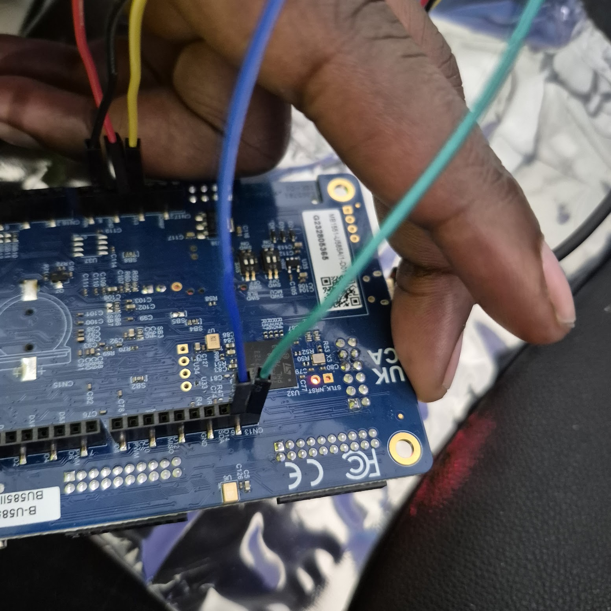

# camera-free-occupancy

Room occupancy detection that never takes a picture. An 8×8 time-of-flight
sensor and an 8×8 thermal array are read by an STM32U585, fused into one
128-value frame, classified on the device, and published into an existing
BACnet / InfluxDB / Grafana building-monitoring stack.

> **Status: hardware bring-up (Gate 1 of 8).** Both sensors are working
> individually on a fixed rig. There is no model or inference yet. See
> [Status](#status) for exactly what works.

*CoworkOS* is the project's working name, and the docs still use it.

## Why no camera

Occupancy sensing is a privacy problem as much as a sensing problem. A camera
answers "is anyone here?" by recording everyone who is. This project answers it
with 128 numbers per frame — distances and temperatures — that cannot identify
anyone, and it does the classification on the sensor node, so even those
numbers stay in the room.

The two sensors cover each other's blind spots:

| Sensor | Measures | Good at | Blind to |
|--------|----------|---------|----------|
| **VL53L5CX** (ST) | Distance per zone, by 940 nm laser | Position, posture, counting; works in the dark | A still person against a wall the same distance away |
| **AMG8833** Grid-EYE (Panasonic) | Radiated heat per pixel | Still occupants — a person is warm whether or not they move | Warm objects that are not people; slow to forget a warm seat |

That first "blind to" is measured, not assumed: a person standing at 1.8 m in
front of a wall at 1.7–2.0 m moved the ToF by ≤ 5 cm, inside its frame-to-frame
noise. The thermal array saw the same person clearly. That is the case for
fusing the two (details in [`NOTES.md`](NOTES.md)).

## Architecture

```
VL53L5CX (8×8 ToF)  +  AMG8833 (8×8 thermal)      shared I2C1 bus
        │ ST ULD in C, via FFI       │ pure Rust driver
        └──────────────┬─────────────┘
          STM32U585 · Cortex-M33 · Rust + Embassy
                       │ two 8×8 grids → 128 values
          STM32Cube AI generated C, via FFI           (Gate 3–4)
                       │ empty / occupied / count + confidence, debounced
          ILI9341 on-device readout                   (Gate 4)
                       │ MQTT
          BACnet objects → InfluxDB → Grafana         (Gate 5)
```

- **Rust where it fits, C where it doesn't.** ST's VL53L5CX driver (the ULD)
  is linked as-is through `cc` + `bindgen`, behind a small, hand-written
  platform layer. The AMG8833 is simple enough that a pure, safe Rust driver
  is the honest choice. Both are deliberate; the reasoning is in
  [`LEARNING.md`](LEARNING.md#7-the-c-interop-story).
- **Inference every 1–2 s, not every frame.** The sensors run at 10 Hz;
  occupancy does not change that fast.
- **Debounce in firmware**, so the device reports a stable state rather than
  leaving that to the dashboard.
- **Planned BACnet objects:** Binary Input 0 (occupied), Analog Input 0
  (people count), Analog Value 0 (confidence).

## Hardware

| Part | Role |
|------|------|
| B-U585I-IOT02A Discovery Kit (STM32U585, Cortex-M33 @ 160 MHz) | MCU |
| VL53L5CX-SATEL breakout | 8×8 time-of-flight, I2C `0x29` |
| SparkFun Grid-EYE AMG8833 (SEN-14607) | 8×8 thermal IR, I2C `0x69` (AD0 strapped high) |
| HiLetgo ILI9341 2.8" TFT, SPI | On-device readout, Gate 4 — display only |

Both sensors share I2C1 on PB8 (SCL) / PB9 (SDA) through the board's ARDUINO
header, mounted side by side on a protoboard rig tilted 15° down.

**Wiring warning.** The ARDUINO digital header on this board (`CN13`) runs in
the *opposite* order to a NUCLEO-64's, and its first position is unpopulated.
Wiring by counted position puts SDA on a ground pin, which looks exactly like
an unfixable short. Wire label to label. The SATEL's `PWR_EN` must also be
driven high (A5 = PB0 on this board), or the sensor never appears on the bus.
The full story, including the wrong turns, is in [`NOTES.md`](NOTES.md).



## Building and running

```bash
# one-time
rustup target add thumbv8m.main-none-eabihf
cargo install probe-rs-tools
pip install matplotlib numpy   # for the heatmap viewer

cd firmware
cargo build --release
cargo run --release --bin tof_range       # live 8×8 ranging over RTT
cargo run --release --bin thermal_probe   # live 8×8 thermal over RTT
```

`probe-rs` flashes over the on-board ST-LINK and streams `defmt` logs back.
`probe-rs list` shows attached probes.

### Firmware programs

The firmware is a library (`src/lib.rs`, drivers in `src/vl53l5cx/` and
`src/amg8833.rs`) plus small single-purpose programs in `src/bin/`:

| Program | Purpose |
|---------|---------|
| `tof_range` | Live VL53L5CX ranging — the Phase 1 checkpoint |
| `thermal_probe` | Live AMG8833 thermal frames, banded against the frame median |
| `tof_probe` | First light through the FFI: ULD `is_alive` and `init` |
| `i2c_scan` | Confirms the bus and finds what answers on it |
| `bus_check` | Electrical check of SDA/SCL before blaming the protocol |
| `pin_wiggle` | Toggles PB8/PB9 for a logic analyser to trace to the header |
| `find_pwren` | Finds which analog pin the SATEL's `PWR_EN` is wired to |

The diagnostic programs are kept on purpose: each one settled a real fault, and
together they are a reusable bring-up kit for this board.

### Heatmap viewer

[`tools/heatmap_viewer.py`](tools/heatmap_viewer.py) turns either stream into
a live heatmap and can record labelled frames to CSV for training:

```bash
cargo run --release --bin tof_range | python3 ../tools/heatmap_viewer.py
cargo run --release --bin thermal_probe \
    | python3 ../tools/heatmap_viewer.py --record session.csv --label empty
python3 tools/heatmap_viewer.py --input saved_log.txt   # replay, no hardware
```

## Status

The project runs as eight gates, each with an exit criterion that is either
met or not ([`occupancy-sensor-project-plan.md`](occupancy-sensor-project-plan.md)
details the phases).

| Gate | | State |
|------|-|-------|
| 1 | Bring-up — both sensors on one bus, fixed rig | **in progress** |
| 2 | Dataset — labelled classes, separable by eye as heatmaps | |
| 3 | Model — confusion matrix on held-out data | |
| 4 | Live inference + on-device readout | |
| 5 | Integrated into BACnet / Grafana | |
| 6 | Same firmware in C/FreeRTOS, measured against this one | |
| 7 | Validated over a multi-day real-room run | |
| 8 | Published | |

**Working now:** Embassy firmware at 160 MHz; the VL53L5CX ULD linked through
FFI and ranging live; the AMG8833 driver in safe Rust; both sensors on a rigid
rig at a derived 15° tilt; the host-side viewer and CSV recorder.

**Next:** establish the ToF grid orientation and check it registers against
the thermal grid (the thermal array is vertically inverted, so the two may be
mirror images), then stream both grids together and tag `phase1-bringup`.
The working list is [`TODO.md`](TODO.md).

## Documentation

| File | What it is |
|------|------------|
| [`LEARNING.md`](LEARNING.md) | Plain-language explanation of the whole project, for someone new to embedded |
| [`NOTES.md`](NOTES.md) | Engineering log: measurements, findings, and the theories that failed |
| [`TODO.md`](TODO.md) | Working list, ordered by when it matters |
| [`occupancy-sensor-project-plan.md`](occupancy-sensor-project-plan.md) | The seven-phase plan |

Write-ups will appear at [mapfumo.net](https://www.mapfumo.net).

## License

Not yet chosen. `firmware/vendor/vl53l5cx/` is ST's VL53L5CX Ultra Lite
Driver, © STMicroelectronics, under ST's own terms.
