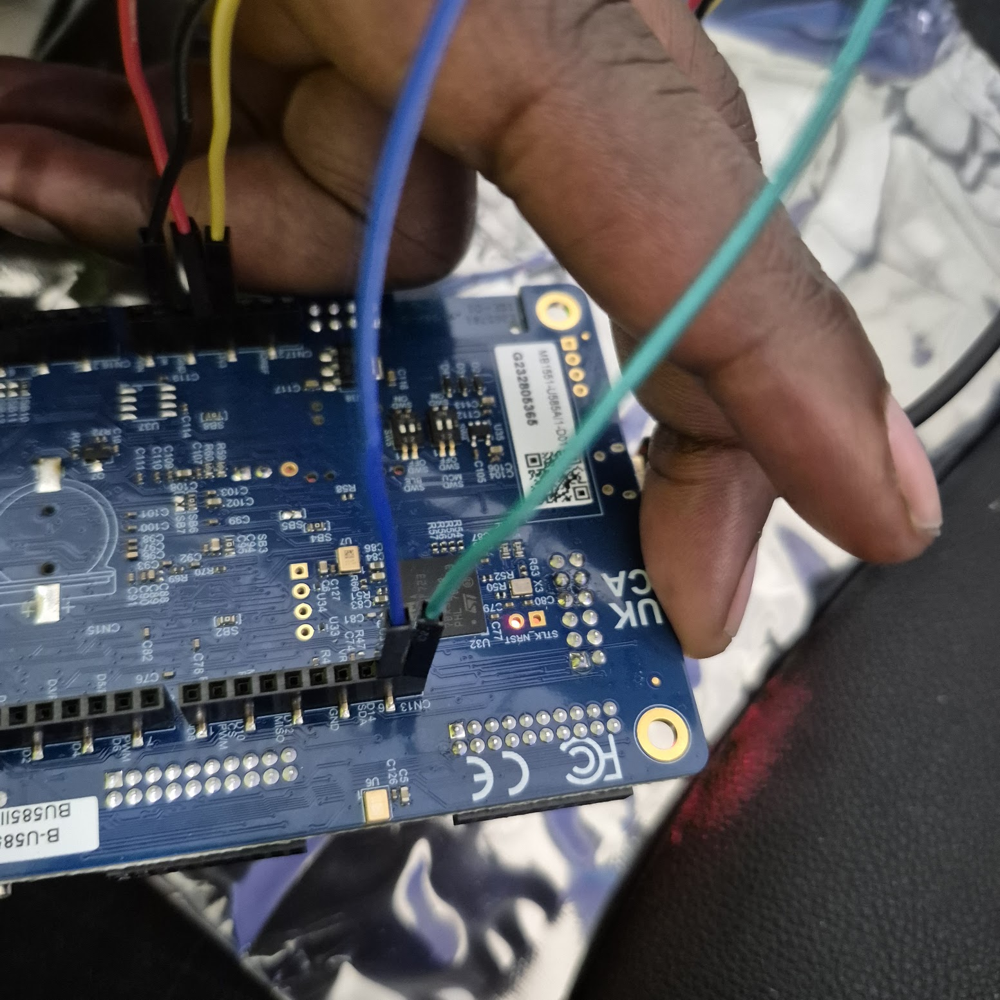

# camera-free-occupancy

Room occupancy detection that never takes a picture. An 8×8 time-of-flight
sensor and an 8×8 thermal array are read by an STM32U585, fused into one
128-value frame, classified on the device, and published into an existing
BACnet / InfluxDB / Grafana building-monitoring stack.

> **Status: live inference (Gate 4 of 8).** A small CNN (11,091
> parameters) runs on the STM32U585 every frame (8.2 ms, ~49 KiB flash,
> 5.75 KiB RAM) and matches the PC bit-for-bit in class. In a 10.8-minute
> live scripted test it made no false empty↔occupied change and caught 12 of
> 12 real ones. On recording rounds it never trained on it scores ~99%
> (71 labelled sessions, 58,451 frames). Display and gateway integration
> are next. See [Status](#status) for exactly what works.

*CoworkOS* is the project's working name, and the docs still use it.

## Why no camera

Occupancy sensing is a privacy problem as much as a sensing problem. A camera
answers "is anyone here?" by recording everyone who is. This project answers it
with 128 numbers per frame — distances and temperatures — that cannot identify
anyone, and it does the classification on the sensor node, so even those
numbers stay in the room.

The two sensors cover each other's blind spots:

| Sensor | Measures | Good at | Blind to |
|--------|----------|---------|----------|
| **VL53L5CX** (ST) | Distance per zone, by 940 nm laser | Position, posture, counting; works in the dark | A still person against a wall the same distance away |
| **AMG8833** Grid-EYE (Panasonic) | Radiated heat per pixel | Still occupants — a person is warm whether or not they move | Warm objects that are not people; slow to forget a warm seat |

That first "blind to" is measured, not assumed: a person standing at 1.8 m in
front of a wall at 1.7–2.0 m moved the ToF by ≤ 5 cm, inside its frame-to-frame
noise. The thermal array saw the same person clearly. That is the case for
fusing the two (details in [`NOTES.md`](NOTES.md)).

## Architecture

```
VL53L5CX (8×8 ToF)  +  AMG8833 (8×8 thermal)      shared I2C1 bus
        │ ST ULD in C, via FFI       │ pure Rust driver
        └──────────────┬─────────────┘
          STM32U585 · Cortex-M33 · Rust + Embassy
                       │ paired frames at 5 Hz → 3×8×8 model input
          STM32Cube AI generated C, via FFI           (Gate 3–4)
                       │ empty / seated / present + confidence, debounced
          ILI9341 on-device readout                   (Gate 4)
                       │ MQTT
          BACnet objects → InfluxDB → Grafana         (Gate 5)
```

- **Rust where it fits, C where it doesn't.** ST's VL53L5CX driver (the ULD)
  is linked as-is through `cc` + `bindgen`, behind a small, hand-written
  platform layer. The AMG8833 is simple enough that a pure, safe Rust driver
  is the honest choice. Both are deliberate; the reasoning is in
  [`LEARNING.md`](LEARNING.md#7-the-c-interop-story).
- **Inference every 1–2 s, not every frame.** Paired frames arrive at 5 Hz;
  occupancy does not change that fast.
- **Three classes, set by the geometry.** Looking down at 49.9°, a standing
  person's head is out of frame, so standing and walking past look alike:
  `empty`, `seated` (one person in the chair), `present` (in view, not
  seated). The honest claim is workstation occupancy, not room counting.
- **Debounce in firmware**, so the device reports a stable state rather than
  leaving that to the dashboard.
- **Planned BACnet objects:** Binary Input 0 (occupied), Analog Input 0
  (people count), Analog Value 0 (confidence).

## Hardware

| Part | Role |
|------|------|
| B-U585I-IOT02A Discovery Kit (STM32U585, Cortex-M33 @ 160 MHz) | MCU |
| VL53L5CX-SATEL breakout | 8×8 time-of-flight, I2C `0x29` |
| SparkFun Grid-EYE AMG8833 (SEN-14607) | 8×8 thermal IR, I2C `0x69` (AD0 strapped high) |
| HiLetgo ILI9341 2.8" TFT, SPI | On-device readout, Gate 4 — display only |

Both sensors share I2C1 on PB8 (SCL) / PB9 (SDA) through the board's ARDUINO
header, mounted side by side on an Arduino-compatible proto shield. The rig hangs from a
desk-clamped boom at 165 cm, looking down at the seat at 49.9° below
horizontal (measured by the board's own accelerometer). Both grids are corrected into one world frame in the driver
(`firmware/src/orientation.rs`) and registered against each other.

**Wiring warning.** The ARDUINO digital header on this board (`CN13`) runs in
the *opposite* order to a NUCLEO-64's, and its first position is unpopulated.
Wiring by counted position puts SDA on a ground pin, which looks exactly like
an unfixable short. Wire label to label. The SATEL's `PWR_EN` must also be
driven high (A5 = PB0 on this board), or the sensor never appears on the bus.
The full story, including the wrong turns, is in [`NOTES.md`](NOTES.md).



## Building and running

```bash
# one-time
rustup target add thumbv8m.main-none-eabihf
cargo install probe-rs-tools
pip install matplotlib numpy   # for the heatmap viewer

cd firmware
cargo build --release
cargo run --release --bin fused_stream    # both sensors, paired frames
cargo run --release --bin tof_range       # live 8×8 ranging over RTT
cargo run --release --bin thermal_probe   # live 8×8 thermal over RTT
```

`probe-rs` flashes over the on-board ST-LINK and streams `defmt` logs back.
`probe-rs list` shows attached probes.

### Firmware programs

The firmware is a library (`src/lib.rs`, drivers in `src/vl53l5cx/` and
`src/amg8833.rs`) plus small single-purpose programs in `src/bin/`:

| Program | Purpose |
|---------|---------|
| `fused_stream` | Both sensors on one bus, paired at 5 Hz — the dataset format. Clears a stuck I2C bus and retries the AMG8833 probe at start-up (`src/i2c_recovery.rs`) |
| `tilt_check` | The rig's mount angle from the on-board accelerometer |
| `tof_range` | Live VL53L5CX ranging — the Phase 1 checkpoint |
| `thermal_probe` | Live AMG8833 thermal frames, banded against the frame median |
| `tof_probe` | First light through the FFI: ULD `is_alive` and `init` |
| `i2c_scan` | Confirms the bus and finds what answers on it |
| `bus_check` | Electrical check of SDA/SCL before blaming the protocol |
| `pin_wiggle` | Toggles PB8/PB9 for a logic analyser to trace to the header |
| `find_pwren` | Finds which analog pin the SATEL's `PWR_EN` is wired to |

The diagnostic programs are kept on purpose: each one settled a real fault, and
together they are a reusable bring-up kit for this board.

### Dataset

[`sessions/`](sessions/) holds every recording as gzipped CSV — raw ToF
distance and status plus temperature, 64 of each per frame — with the
format in [`sessions/README.md`](sessions/README.md). Walking-past sessions
were filmed by a webcam *only to label them*; the footage stays on the
recording machine, and only the derived per-frame labels are committed.

| Class | Frames | Sessions cover |
|-------|-------:|----------------|
| `empty` | 27,381 | Chair on its marks, pushed in, pulled out, turned, gone |
| `seated` | 16,777 | Upright, leaning back, leaning in |
| `present` | 13,358 | Standing at the desk, reaching across, walking past |

Recorded 2026-11-22 to 24 — each class morning, afternoon and evening on
two days — one person, one room. Frames within a session are
near-duplicates, so this is 70 situations rather than 57,000 independent
samples — split by session, not
by frame.

| Tool | Purpose |
|------|---------|
| [`tools/heatmap_viewer.py`](tools/heatmap_viewer.py) | Live view and CSV recorder (below) |
| [`tools/label_frames.py`](tools/label_frames.py) | Step through a session beside its video and label each frame |
| [`tools/class_look.py`](tools/class_look.py) | Gate 2 exit check: per-class average grids and a frame-level scatter into `figures/gate2/` |
| [`tools/encode.py`](tools/encode.py) | The model input: 3×8×8 per frame — ToF valid mask, distance with invalid zones read as far, thermal excess over the frame median |

```bash
python3 tools/class_look.py sessions figures/gate2/<round-name>
python3 tools/encode.py sessions          # per-session class counts
```

Why the encoding has a separate valid mask — a "valid" 0 mm reading that
clustered in one corner of the empty sessions — is in
[`NOTES.md`](NOTES.md) and the
[write-up](https://www.mapfumo.net/posts/2026/november/camera-free-occupancy-building-the-dataset/).

### Model

[`ml/`](ml/) trains and scores the classifier. Splits are by *round* — one
daypart on one day — never by frame, so every score is on a day the model
never saw (leave-one-round-out, six rounds).

| | accuracy | balanced |
|---|---:|---:|
| Logistic regression (baseline) | 98.2% | 97.8% |
| **CNN**, 11,091 parameters, three seeds | **99.1%** | **99.0–99.1%** |

Across the 40 empty-room sessions the CNN calls "occupied" on 0–3 of 24,772
frames; nearly all remaining errors are at the edges of walking passes. On
the STM32U585 (ST Edge AI Core 4.0, float32): ~49 KiB flash, 5.75 KiB RAM,
186,787 MACC per inference; the generated C model matches PyTorch.

The deployed model (2026-11-24) adds one session of standing bent over the
keyboard, a posture the first model called `seated` on every frame. On the
live test, which no model trained on, that stretch goes from 0% to 86–99%
`present`; the price is ~0.5 pt of seated recall on hunched sitting. Scored
with `ml/live_eval.py`; see NOTES, "Retraining for the bent-over posture".

```bash
python3 -m venv ml/.venv && ml/.venv/bin/pip install torch scikit-learn onnx onnxruntime \
    --extra-index-url https://download.pytorch.org/whl/cpu
ml/.venv/bin/python ml/baseline.py          # baselines
ml/.venv/bin/python ml/train.py --seeds 3   # CNN, leave-one-round-out
ml/.venv/bin/python ml/train.py --final     # train on everything, export ONNX
```

Details and error analysis: [`NOTES.md`](NOTES.md), "Phase 3 — Model".

### Heatmap viewer

[`tools/heatmap_viewer.py`](tools/heatmap_viewer.py) turns any of the streams
into a live heatmap and can record labelled frames to CSV for training. With
`fused_stream` it shows both sensors side by side and records one row per
pair: raw ToF distance, ToF status and temperature, 64 of each.

```bash
cargo run --release --bin fused_stream \
    | python3 ../tools/heatmap_viewer.py --record session.csv --label empty
cargo run --release --bin tof_range | python3 ../tools/heatmap_viewer.py
cargo run --release --bin thermal_probe \
    | python3 ../tools/heatmap_viewer.py --record session.csv --label empty
python3 tools/heatmap_viewer.py --input saved_log.txt   # replay, no hardware
```

## Status

The project runs as eight gates, each with an exit criterion that is either
met or not ([`occupancy-sensor-project-plan.md`](occupancy-sensor-project-plan.md)
details the phases).

| Gate | | State |
|------|-|-------|
| 1 | Bring-up — both sensors on one bus, fixed rig | done — `phase1-bringup` |
| 2 | Dataset — labelled classes, separable by eye as heatmaps | done — `phase2-data` |
| 3 | Model — confusion matrix on held-out data | done — `phase3-model` |
| 4 | Live inference + on-device readout | **in progress** — inference and debounce done; display next |
| 5 | Integrated into BACnet / Grafana | |
| 6 | Same firmware in C/FreeRTOS, measured against this one | |
| 7 | Validated over a multi-day real-room run | |
| 8 | Published | |

**Working now:** Embassy firmware at 160 MHz; the VL53L5CX ULD linked through
FFI and ranging live; the AMG8833 driver in safe Rust; both grids in one world
frame and registered against each other; the rig re-aimed at the desk, where
both sensors clearly separate a seated person from an empty chair; a paired
two-sensor stream at 5 Hz; the host-side viewer and CSV recorder; 71
labelled sessions in which `empty`, `seated` and `present` separate by eye in
every daypart; the model input encoding; the CNN running on the board every
frame (ST Edge AI C over FFI, 8.2 ms), with two debouncers (occupancy and
class, 8 frames in a row each) turning frames into a reported state; a
stuck-bus recovery on the I2C line. A 10.8-minute live scripted test scored
against webcam labels: 0 false empty↔occupied changes, 12/12 caught.

A ten-minute soak confirmed the ToF's self-heating does not reach the
thermal image.

**Next:** Gate 4 — show the state on the ILI9341 (class, confidence, small
live heatmap), mounted on the pole. The working list is [`TODO.md`](TODO.md).

## Documentation

| File | What it is |
|------|------------|
| [`LEARNING.md`](LEARNING.md) | Plain-language explanation of the whole project, for someone new to embedded |
| [`NOTES.md`](NOTES.md) | Engineering log: measurements, findings, and the theories that failed |
| [`COLLECTION.md`](COLLECTION.md) | Gate 2 recording procedure: classes, labels, and the rules each session follows |
| [`sessions/README.md`](sessions/README.md) | Dataset file format, columns and per-frame labels |
| [`TODO.md`](TODO.md) | Working list, ordered by when it matters |
| [`occupancy-sensor-project-plan.md`](occupancy-sensor-project-plan.md) | The seven-phase plan |

Write-ups at [mapfumo.net](https://www.mapfumo.net): [building the
dataset](https://www.mapfumo.net/posts/2026/november/camera-free-occupancy-building-the-dataset/).

## License

[MIT](LICENSE), except:

- `firmware/vendor/vl53l5cx/` — ST's VL53L5CX Ultra Lite Driver (v2.0.1),
  © STMicroelectronics, under [BSD-3-Clause](firmware/vendor/vl53l5cx/LICENSE.txt).
- `firmware/vendor/ai_model/` — C generated by ST Edge AI Core from this
  project's model, © STMicroelectronics, under ST's
  [SLA0104](firmware/vendor/ai_model/LICENSE.txt) (runs on ST devices only).
  ST's runtime library is linked from a local ST Edge AI install and is not
  redistributed here.
