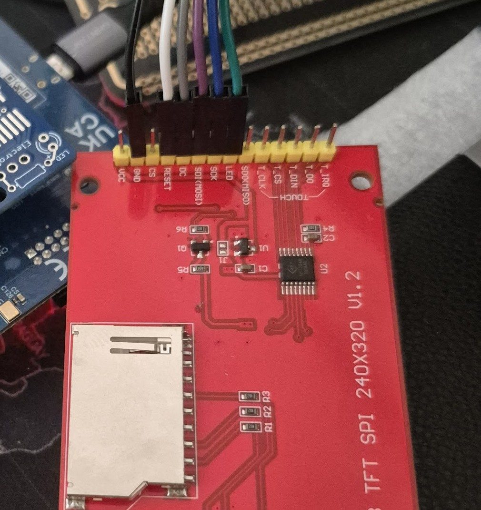

# ILI9341 display wiring

The 2.8" ILI9341 TFT module (red board, "2.8 TFT SPI 240X320 V1.2", 14-pin
header), mounted at the top corner of the pole, facing the door. It
connects to the proto shield through 40 cm Dupont leads.

**As built, 2026-11-28:** 40 cm female–female Dupont leads from the shield
to the module's header, not yet the planned ribbon and perfboard carrier
(below). Proven at 5 MHz by `display_hello`, `display_test` and the live
`fused_stream`. LED is fed from 5V alongside VCC. The plan below is still
the tidy version to build.

**Wire label to label, never by counted position.** This board's ARDUINO
header is not ordered like a NUCLEO-64's (CLAUDE.md, the CN13 story).

## Pin map

The ARDUINO-to-MCU mapping comes from Zephyr's board definition for this
board (`boards/st/b_u585i_iot02a/arduino_r3_connector.dtsi`, where
`arduino_spi = spi1`). It agrees with the two pins already proven on this
board by hand: A5 = PB0 and D14/D15 = PB9/PB8. ST's manual (UM2839) could
not be downloaded when this was written; check its solder-bridge table for
D8–D13 when it can be. The display test proves the routing anyway: if the
screen draws, every signal arrived.

| Display pin | Signal | Shield (ARDUINO label) | MCU pin | Notes |
|---|---|---|---|---|
| VCC | power | **5V** | — | The module's own regulator (U1) makes 3.3 V; leave **J1 open** |
| GND | ground | **GND** | — | |
| CS | chip select | **D10** | PE12 | GPIO, driven by software |
| RESET | reset | **D9** *or tie to VCC on the carrier* | PA8 | `RESET_WIRED` in `display_test.rs` |
| DC | data / command | **D8** | PC1 | GPIO |
| SDI (MOSI) | data in | **D11** | PE15 | SPI1_MOSI |
| SCK | clock | **D13** | PE13 | SPI1_SCK |
| LED | backlight | *tie to VCC on the carrier* | — | Drives the module's own transistor (Q1); always on |
| SDO (MISO) | — | not connected | | Write-only driver |
| T_CLK, T_CS, T_DIN, T_DO, T_IRQ | touch | not connected | | Touch unused (CLAUDE.md) |

**VCC and LED are two separate supplies, and both must be connected.**
VCC feeds the regulator that powers the ILI9341 controller; LED only
switches the backlight. With LED powered and VCC open the backlight lights
but nothing is ever drawn, and the screen flickers grey as the signal pins
change (the controller half-powers through them). This cost a bench
session on 2026-11-28.

D12 (PE14, SPI1_MISO) stays free. The I2C sensors on D14/D15 and PWR_EN
on A5 are untouched.

## The harness: 6 wires minimum, 8 recommended

The minimum is 6: VCC, GND, SCK, SDI, CS, DC, with RESET and LED tied to
VCC on the carrier.

**Recommended: 8 conductors, in this order across the ribbon:**

```
1 VCC (5V)
2 GND
3 SCK      <- clock, with ground on both sides
4 GND
5 SDI (MOSI)
6 CS
7 DC
8 RESET    (D9; or leave unconnected at the shield if tied high on the carrier)
```

- **Ground beside SCK on both sides** is what keeps a 30 cm unshielded run
  clean. The clock is the only signal with fast edges, all the time.
- 8-way ribbon with a 1×8 female header crimped or soldered at each end;
  male 1×8 headers on the shield and the carrier. Both ends unplug.
- Keep it away from the USB and power cables, and tape or clip it along
  the pole.
- **If pixels garble:** lower `SPI_MHZ` (5 → 2.5), then add 33–47 Ω in
  series with SCK at the shield end. Firmware already sets the slowest pin
  edge rate (`Speed::Low`).

## The carrier

- 14-pin **female** header on perfboard; the display plugs in.
- Four M3 nylon standoffs at the display's corner holes, through 3.2 mm
  holes drilled in the perfboard. The header then carries no load.
- On the carrier: a 1×8 male header for the harness, wired to the display's
  pins by short links; **LED → VCC**; **RESET → VCC** if it isn't run to
  D9.
- Fix the carrier to the pole with standoffs or zip ties through the
  perfboard's own corner holes. Nylon, so nothing shorts against the pole.

## Placement

Out of both sensors' field of view, and **at least 20–30 cm from the
AMG8833**. The backlight is a heat source, and the thermal array would see
it as a warm spot. **Facing the door**, not the chair: the reader is the
person arriving (and the Gate 4 exit test is read while walking in); the
person seated already knows, and a bright screen in their eyeline could
change how they sit.

After mounting, check the head was not moved:

1. `cargo run --release --bin tilt_check` — tilt and roll on the LCD, green
   within ±1° of the reference pose (`orientation::MOUNT_*`, 45.4° / 167.2°
   since 2026-11-28).
2. `cargo run --release --bin align` — chair on its marks, nobody in view.
   The accelerometer cannot see a turn about the vertical axis; the scene
   can. The big number is how many ToF zones differ from the empty-room
   reference; "shift" is how many zone columns the view is turned. Pan the
   head until shift is 0 and the number is at its lowest (~16 in the
   current pose, whose references are at the old one).
3. Record ~60 s empty and run `tools/compare_empty.py` on it: zones changed
   against the references' own spread, and any thermal hot spot (the
   backlight, if it is in view). On 2026-11-28: no hot spot.

## Power

Everything runs from the ST-LINK USB's 5 V. Typical figures, not measured
on this build:

| Load | Approx. |
|---|---|
| ILI9341 module, mostly backlight | 50–100 mA at 5 V |
| VL53L5CX ranging (SATEL) | 60–100 mA |
| STM32U585 at 160 MHz + AMG8833 + IMU | ~25 mA |
| ST-LINK and board overhead | ~50–100 mA |
| **Total** | **~200–325 mA** |

That is comfortably under a USB 2.0 port's 500 mA. It runs off **5 V**, not
the board's 3V3 pin, so the backlight does not load the regulator that
feeds the MCU and sensors. Check that UM2839 gives no lower limit on the
ARDUINO 5V pin when the manual can be fetched. To measure it, use an inline
USB power meter between the PC and the ST-LINK port, with the display on and
then off.

## Bench test first

Three programs, simplest first:

| Program | What it does |
|---|---|
| `display_hello` | One static screen at 2.5 MHz: HELLO, red / green / blue squares. Nothing changes after, so any flicker is power, not SPI. |
| `display_pins` | Each signal (SCK, SDI, CS, DC, RESET) high on its own for 5 s in turn. Measure at the **display's** pins with a multimeter: proves every wire end to end. |
| `display_test` | Fills, orientation marker, then the readout cycling with a fake heatmap; every draw timed. |

`display_test` timings at 5 MHz, the same with the panel connected:

| Draw | Time |
|---|---|
| Full-screen fill | 252 ms |
| State change (band + 4× word) | 160–187 ms, only on change |
| Confidence (3× digits) | 25 ms, only on change |
| Heatmap, first full draw | 43 ms |
| Heatmap per frame (changed cells only) | 0.3–5 ms |

The frame budget is 200 ms at 5 Hz.

In the live program (`fused_stream`), with sensors and model: a state
change costs 212–220 ms, so that one frame overruns; every other frame
draws in under 50 ms (draws over 50 ms are logged as `display frame N`).

## Troubleshooting (all seen on 2026-11-28)



*The grey-flicker fault as found: VCC and CS bare, the plug one position
over. The labels are printed above every pin.*

| Screen | Cause | Fix |
|---|---|---|
| Plain white, steady | Powered, never initialised: no data arriving, or the display was powered after the program started | Restart the program (it initialises once, at start). Then check SCK D13, SDI D11, CS D10, DC D8, RESET D9, label to label |
| Grey, flickering dark / grey / bright | **VCC open**, LED powered: the controller half-powers through the signal pins | Connect VCC to 5V. Check the plug is not one pin off at the module |
| Was working, now white after handling | Twisted or loose Dupont ends: a twisted crimp stops gripping the pin | Replace the leads; don't rotate Dupont ends on the pins |
| USB drops (`device disconnected`) | Unplugged, or a loose bare end shorting 5V | Look for bare ends near 5V / GND before re-plugging |

The board cannot tell any of these apart: the driver is write-only and the
log says "drawn" either way. Look at the screen, then use `display_pins`.
